# IT-Service-Request-Portal

[](https://github.com/rainysanityy/servicerequest/actions/workflows/ci.yml)


Self-Service-Portal für IT-Anfragen in Unternehmen – **Hardware (einzeln oder als Bundle), Software, Telefonie, Berechtigungen & VPN, Benutzerkonten, virtuelle Maschinen, Zertifikate und allgemeine Anfragen** – mit Keycloak-Anmeldung (OIDC + PKCE), rollenbasierter Zugriffskontrolle, einer Oberfläche im **Material 3 Expressive Design** (Dark/Light Mode) und gehärtetem Betrieb mit **rootless Docker auf Fedora Server** nach BSI IT-Grundschutz und NIST SP 800-53.

> **Projektstatus:** Release 1.0.0. Die [CI-Pipeline](.github/workflows/ci.yml) ist grün: Typecheck, Unit-Tests und Build von Backend und Frontend, Migrationen und Rechteprüfung gegen PostgreSQL 17 sowie der Build aller Container-Images. Noch offen ist ein End-to-End-Test im Browser mit Keycloak-Login (siehe Abnahmeliste im Betriebskonzept).

---

## Inhalt

- [Screenshots](#screenshots)
- [Funktionen](#funktionen)
- [Architektur](#architektur)
- [Schnellstart](#schnellstart)
- [Rollen](#rollen)
- [Sicherheit](#sicherheit)
- [Dokumentation](#dokumentation)
- [Repository-Struktur](#repository-struktur)
- [Entwicklung](#entwicklung)
- [Betrieb](#betrieb)

## Screenshots

<table>
  <tr>
    <td width="50%">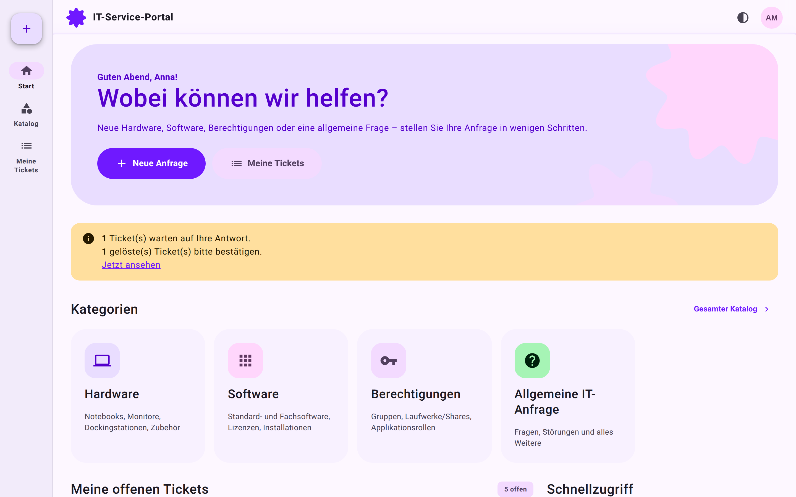<br><sub><b>Startseite</b> – heller Modus</sub></td>
    <td width="50%">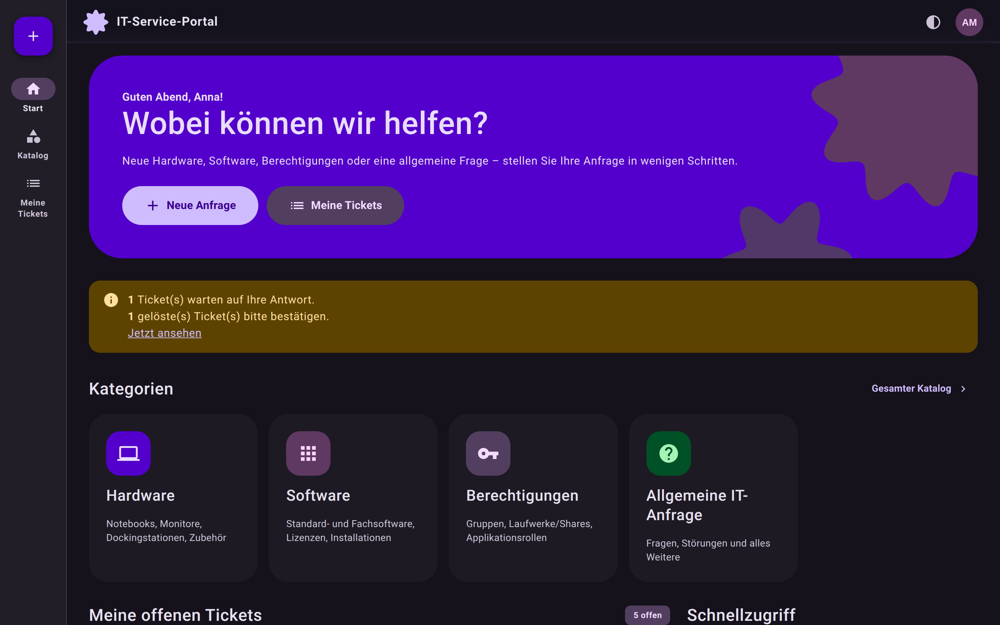<br><sub><b>Startseite</b> – dunkler Modus</sub></td>
  </tr>
  <tr>
    <td>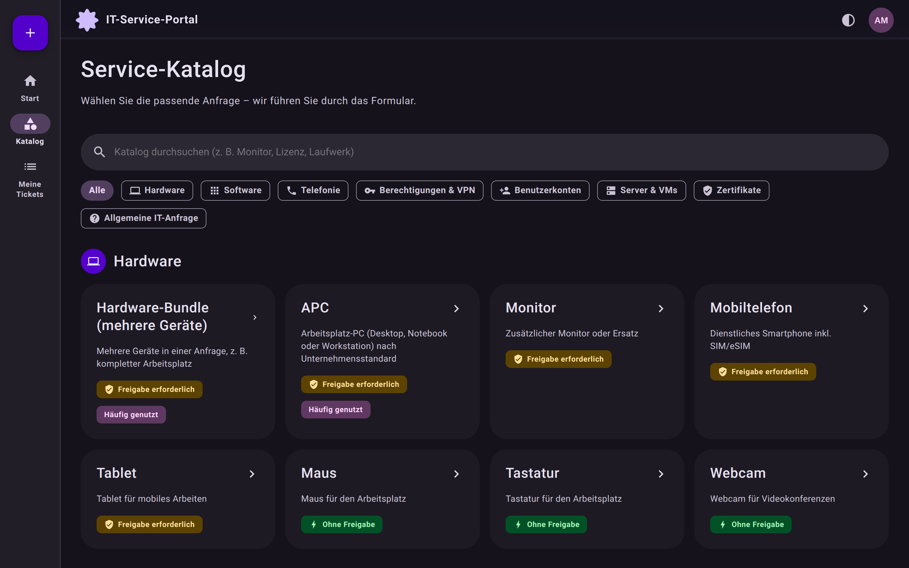<br><sub><b>Service-Katalog</b> mit Suche und Kategorien</sub></td>
    <td>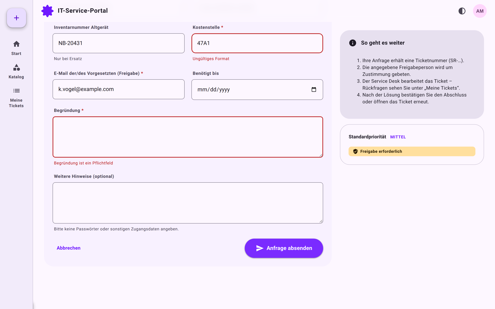<br><sub><b>Geführtes Formular</b> mit Eingabeprüfung</sub></td>
  </tr>
  <tr>
    <td>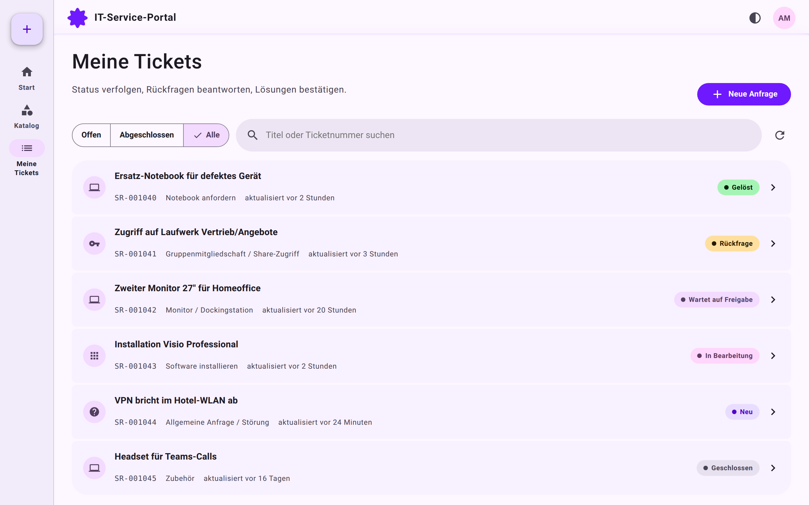<br><sub><b>Meine Tickets</b> – Filter, Suche, Status</sub></td>
    <td>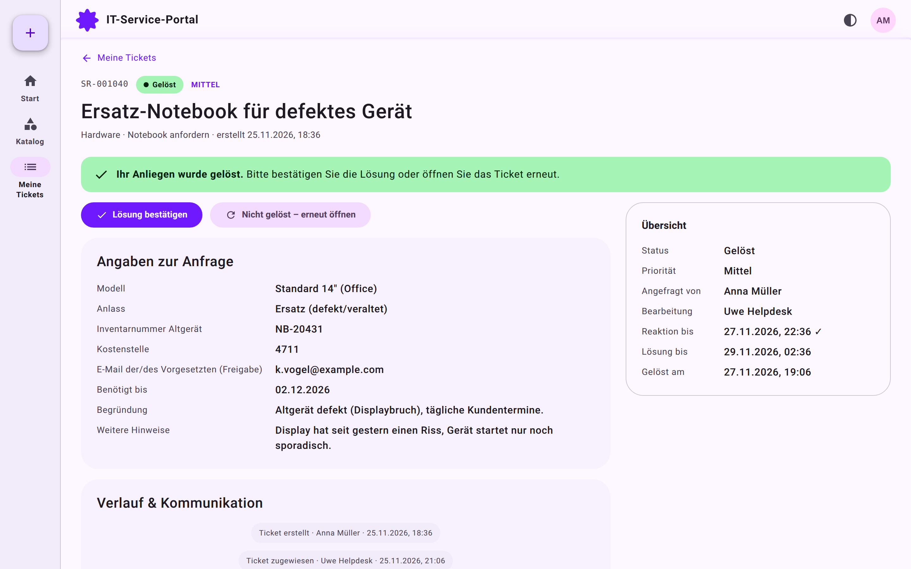<br><sub><b>Ticketdetails</b> – Lösung bestätigen oder erneut öffnen</sub></td>
  </tr>
  <tr>
    <td>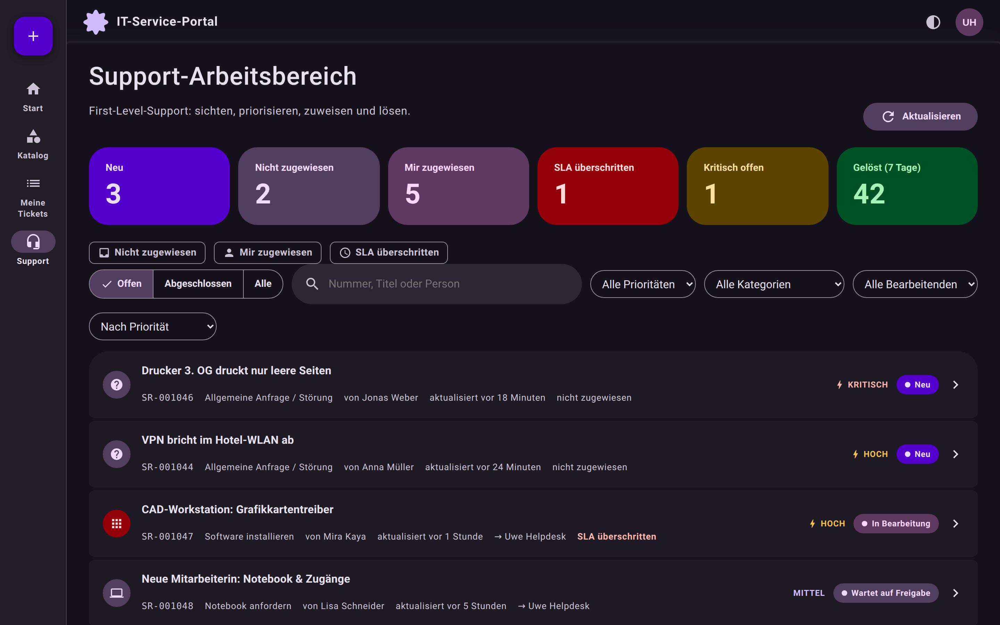<br><sub><b>Support-Arbeitsbereich</b> – Kennzahlen, Filter, SLA</sub></td>
    <td>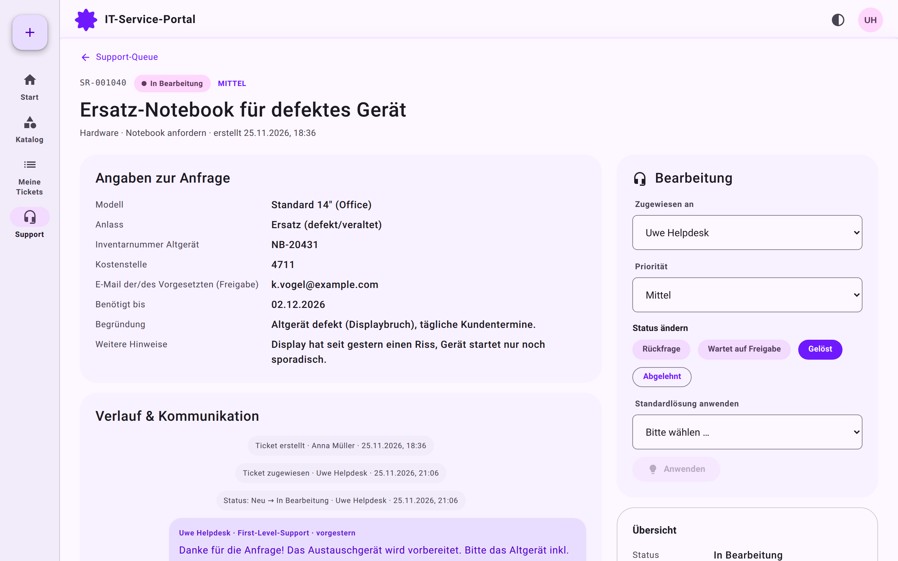<br><sub><b>Bearbeitung</b> – Zuweisung, Priorität, Workflow, Standardlösungen</sub></td>
  </tr>
  <tr>
    <td>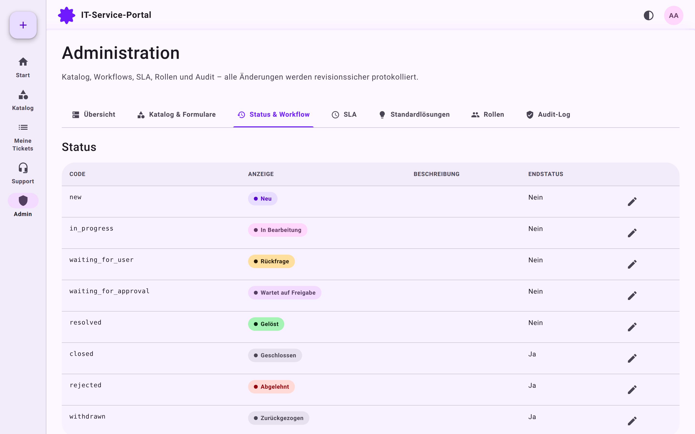<br><sub><b>Administration</b> – Status & Workflow</sub></td>
    <td>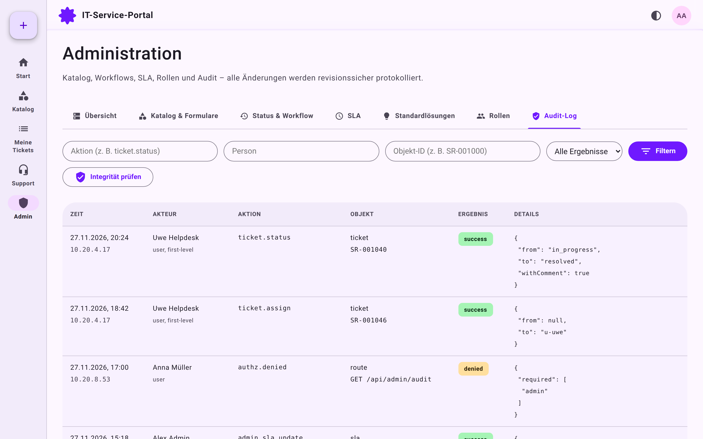<br><sub><b>Audit-Log</b> mit Integritätsprüfung</sub></td>
  </tr>
</table>

<p align="center">
  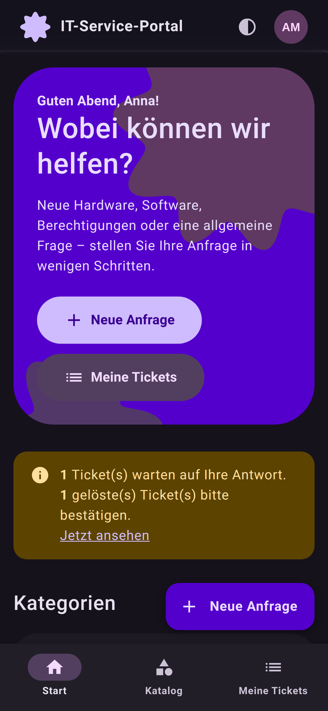&nbsp;&nbsp;
  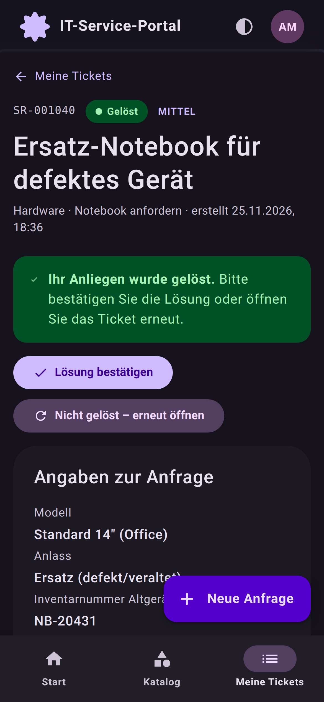<br>
  <sub><b>Mobile Ansicht</b> mit Navigationsleiste unten</sub>
</p>

<sub>Die Aufnahmen entstehen automatisch über den Workflow <a href=".github/workflows/screenshots.yml">Screenshots</a> (Playwright). Keycloak und API werden dabei mit Beispieldaten simuliert; alle Namen und Tickets sind fiktiv.</sub>

## Funktionen

**Für Mitarbeitende**
- Startseite mit Kategorien, Schnellzugriff und Hinweisen auf offene Rückfragen
- Service-Katalog mit Suche und geführten Formularen (Pflichtfelder, Formatprüfung, bedingte Felder, Befristung von Berechtigungen):

  | Kategorie | Katalogeinträge |
  |---|---|
  | Hardware | APC, Monitor, Mobiltelefon, Tablet, Maus, Tastatur, Webcam – einzeln oder als **Bundle** mit Stückzahlen |
  | Software | Software anfordern (Freitext) |
  | Telefonie | Softphone oder Hardphone (Tisch-, Video-, DECT-, Konferenztelefon) |
  | Berechtigungen & VPN | Netzlaufwerke, Mail-Postfächer (Lesen, Vollzugriff, Senden als …), VPN-Zugang |
  | Benutzerkonten | Neues Konto mit Berechtigungen einer Referenzperson |
  | Server & VMs | Virtuelle Maschine mit OS, vCPU, RAM, Platten, Netzsegment, Backup, Monitoring |
  | Zertifikate | SSL/TLS-Serverzertifikat, E-Mail-Zertifikat (S/MIME) |
  | Allgemein | Fragen und Störungen |

- „Meine Tickets“ mit Filter, Suche, Statusverfolgung, Verlauf, Rückfragen beantworten, Lösung bestätigen/erneut öffnen
- Dark-, Light- und System-Modus, wählbare Farbpaletten, barrierearme Bedienung (Tastatur, ARIA, reduzierte Bewegung)

**Für den First-Level-Support**
- Support-Queue mit Kennzahlen, Schnellfiltern, Sortierung nach Priorität/SLA
- Annehmen/Zuweisen, Priorisieren (SLA-Neuberechnung), Statuswechsel nach Workflow, interne Notizen, Standardlösungen

**Für die Administration**
- Katalog und Formulare (JSON-Definition mit bedingten Feldern `when`, Bundle-Regel `requireOneOf`, serverseitiger Validierung inkl. ReDoS-Schutz), Kategorien
- Status und Workflow-Matrix je Rolle, SLA-Zeiten, Standardlösungen
- Rollenübersicht mit Rezertifizierungs-Warnungen, Audit-Log mit Filter und Integritätsprüfung (Hash-Kette), Systemsicht

## Architektur

<p align="center">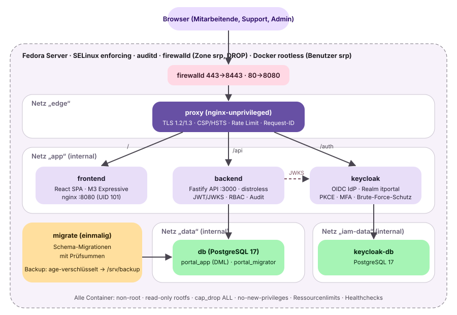</p>

| Dienst | Technologie | Aufgabe |
|---|---|---|
| `proxy` | nginx-unprivileged | TLS (BSI TR-02102-2), Security-Header/CSP, Rate Limiting, Admin-Konsole nur aus Admin-Netz |
| `frontend` | React 18, TypeScript, Vite | Single-Page-App, Material 3 Expressive, keycloak-js (PKCE S256) |
| `backend` | Node.js 22, Fastify 5, Zod, distroless | REST-API, JWT-Prüfung via JWKS, RBAC je Endpunkt, Audit-Log |
| `migrate` | wie Backend (einmaliger Job) | Schema-Migrationen mit Prüfsummen als separate DB-Rolle |
| `db` | PostgreSQL 17 | Portal-Daten, getrennte Rollen `portal_migrator` / `portal_app` |
| `keycloak` + `keycloak-db` | Keycloak 26, PostgreSQL 17 | Identity Provider, Realm `itportal` |

Alle Container laufen **non-root**, mit **read-only Root-Dateisystem**, `cap_drop: ALL`, `no-new-privileges`, Ressourcenlimits und Healthchecks. Nur der Proxy hängt an einem Netz mit Außenverbindung; alle anderen Netze sind `internal`.

## Schnellstart

> Voraussetzungen: Fedora Server ≥ 41, ein Admin-Konto mit SSH-Schlüssel, DNS-Name und TLS-Zertifikat (für Tests kann ein selbstsigniertes erzeugt werden).

```bash
git clone https://github.com/rainysanityy/servicerequest.git
cd servicerequest

# 1. Server härten (einmalig, als root) – Details: fedora-hardening/README.md
sudo ADMIN_CIDR=10.10.0.0/24 ADMIN_USERS="max.admin" fedora-hardening/scripts/harden.sh
sudo systemctl reboot

# 2. Projekt für das Dienstkonto bereitstellen
sudo rsync -a ./ /srv/srp/app/ && sudo chown -R srp:srp /srv/srp/app
sudo -u srp bash
export XDG_RUNTIME_DIR=/run/user/$(id -u) DOCKER_HOST=unix:///run/user/$(id -u)/docker.sock
cd /srv/srp/app

# 3. Secrets, Konfiguration, Zertifikat
./scripts/init-secrets.sh            # erzeugt secrets/* und .env
vi .env                              # PORTAL_HOSTNAME, ADMIN_ALLOW_CIDR, BACKUP_AGE_RECIPIENT
./scripts/gen-selfsigned-cert.sh     # nur Test – Produktion: PKI-Zertifikat nach proxy/certs/
./scripts/load-demo-users.sh         # optional, nur Test

# 4. Starten und prüfen
docker compose build
docker compose up -d
docker compose ps
./scripts/smoke-test.sh
```

Danach `https://<PORTAL_HOSTNAME>/` öffnen. Demo-Konten (nur nach `load-demo-users.sh`): `anna.mueller` (Mitarbeitende), `uwe.helpdesk` (First-Level), `alex.admin` (Admin) – Initialpasswörter in [`keycloak/demo-users/`](keycloak/demo-users/), Passwortwechsel beim ersten Login, Support/Admin richten TOTP ein.

> **Reproduzierbare Builds:** Einmalig `npm install` in `frontend/` und `backend/` ausführen und die erzeugten `package-lock.json` committen. Die Dockerfiles und die CI verwenden dann automatisch `npm ci`.

## Rollen

| Realm-Rolle | Keycloak-Gruppe | Berechtigungen |
|---|---|---|
| `user` | `/Mitarbeitende` | Katalog, Requests erstellen, eigene Tickets einsehen/kommentieren, Lösung bestätigen, zurückziehen |
| `first-level` | `/IT-UHD` | zusätzlich Support-Queue, Zuweisung, Priorität, Status, Rückfragen, interne Notizen, Standardlösungen |
| `admin` | `/IT-Portal-Admins` | zusätzlich Katalog/Formulare, Workflow, SLA, Standardlösungen, Rollenübersicht, Audit-Log, Systemsicht |

Rollen werden **serverseitig an jedem Endpunkt** geprüft; Objektzugriffe zusätzlich auf Eigentümerschaft (fremde Tickets → 404). Die Oberfläche blendet nur aus.

## Sicherheit

| Bereich | Maßnahmen |
|---|---|
| Identität | OIDC Authorization Code + PKCE, Tokens nur im Speicher, Access Token 5 min, Refresh-Token-Rotation, Brute-Force-Schutz, MFA für Support/Admin |
| API | Prüfung von Signatur, `iss`, `aud`, `azp`, `exp`; Zod-Schemas (strict) für alle Eingaben; parametrisierte SQL; Origin-Prüfung; Rate Limiting; optimistische Sperren |
| Web | CSP ohne `unsafe-inline`, HSTS, X-Frame-Options, Permissions-Policy, keine externen Ressourcen |
| Daten | TLS 1.2/1.3, LUKS2 für `/srv`, age-verschlüsselte Backups, DB-Rollen nach Least Privilege |
| Nachvollziehbarkeit | Append-only Audit-Log (Trigger + Rechte) mit SHA-256-Hash-Kette, Request-ID End-to-End, auditd, journald mit FSS |
| Plattform | SELinux enforcing, firewalld Default DROP, SSH nach TR-02102-4, sysctl-Härtung, AIDE, automatische Sicherheitsupdates, rootless Docker |
| Datenschutz | Anonymisierung abgeschlossener Tickets (3 Jahre), Löschung Audit-Log (1 Jahr) und IP-Adressen (90 Tage), Pseudonymisierung inaktiver Profile |

Schwachstellen bitte vertraulich melden – siehe [SECURITY.md](SECURITY.md).

## Dokumentation

| Dokument | Zielgruppe |
|---|---|
| [Benutzerhandbuch](docs/pdf/Benutzerhandbuch.pdf) | Mitarbeitende: Login, Anfragen, Tickets, Dark/Light Mode |
| [Support- & Admin-Handbuch](docs/pdf/Support-und-Admin-Handbuch.pdf) | First-Level-Support, Portal-Administration |
| [Informationssicherheitskonzept](docs/pdf/Infosicherheitskonzept.pdf) | ISB, IT-Leitung, Revision (Schutzbedarf, Risiken, BSI/NIST-Mapping, Incident-Handling) |
| [Datenschutzkonzept](docs/pdf/Datenschutzkonzept.pdf) | DSB, Betriebsrat (Zwecke, Rechtsgrundlagen, Fristen, TOM, Betroffenenrechte) |
| [Betriebskonzept](docs/pdf/Betriebskonzept.pdf) | IT-Betrieb (Inbetriebnahme, Monitoring, Backup/Restore, Updates, Eskalation) |
| [Fedora-Härtung](fedora-hardening/README.md) | IT-Betrieb |

Die PDFs werden aus den Markdown-Quellen in [`docs/src/`](docs/src/) erzeugt: `./docs/build-docs.sh` (benötigt pandoc, Python mit `playwright`, `pypdf`, `pdfplumber` und Chromium/Chrome).

## Repository-Struktur

```
.
├── backend/              Fastify-API (TypeScript), Tests (vitest)
│   └── migrations/       SQL-Schema & Stammdaten
├── frontend/             React-SPA, Designsystem in src/theme/
├── db/init/              PostgreSQL-Rollen (Migrator / App)
├── keycloak/             Image, Realm-Import, Demo-Benutzer
├── proxy/                nginx-Konfiguration, Templates, Security-Header
├── scripts/              Secrets, Zertifikat, Backup/Restore, Smoke-Test
├── fedora-hardening/     Ansible-Playbook, Bash-Skripte, Konfigurationsdateien
├── docs/                 Markdown-Quellen, Grafiken, PDFs, Screenshots, Build-Skript
├── .github/              CI- und Screenshot-Workflow, Dependabot
├── docker-compose.yml
└── .env.example
```

## Entwicklung

```bash
# Backend
cd backend && npm install
npm test                 # Unit-Tests (Token-Prüfung, Formularvalidierung, Workflow, Bereinigung)
npm run typecheck
npm run dev              # benötigt Umgebungsvariablen, siehe src/config.ts

# Frontend
cd frontend && npm install
npm run dev              # Vite-Dev-Server, Proxy auf https://localhost:8443 (laufender Stack)
npm run build
```

Die CI ([`.github/workflows/ci.yml`](.github/workflows/ci.yml)) führt bei jedem Push aus: Typecheck, Tests und Build für Backend und Frontend, Migrationen gegen PostgreSQL 17 inkl. Rechteprüfung der App-Rolle, Validierung der Compose-Datei und Skripte, Container-Builds und einen Trivy-Scan. Dependabot hält npm-Pakete, Basis-Images und Actions aktuell.

## Betrieb

| Aufgabe | Befehl |
|---|---|
| Status | `docker compose ps` |
| Logs | `docker compose logs -f backend proxy` |
| Update | `git pull && docker compose build --pull && docker compose up -d` (Migrationen laufen automatisch) |
| Backup | `./scripts/backup.sh` (täglich per `srp-backup.timer`) |
| Restore | `./scripts/restore.sh /srv/backup/srp/<zeitstempel> ~/age-identity.txt` |
| Härtungsnachweis | `sudo fedora-hardening/scripts/verify.sh` |

Details im [Betriebskonzept](docs/pdf/Betriebskonzept.pdf). Änderungen: [CHANGELOG.md](CHANGELOG.md).

## Lizenz

Noch keine Lizenz festgelegt – ohne Lizenzdatei gelten alle Rechte als vorbehalten.
