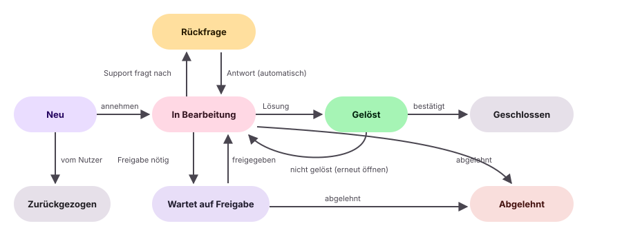

# Einleitung

Das **IT-Service-Portal** ist der zentrale Einstiegspunkt für alle Anliegen an die IT. Über das Portal beantragen Sie neue Hardware, Software und Berechtigungen, melden Störungen und verfolgen jederzeit den Bearbeitungsstand Ihrer Anfragen.

Dieses Handbuch richtet sich an alle Mitarbeitenden und beschreibt:

* die Anmeldung über das zentrale Unternehmenskonto (Keycloak),
* den Aufbau der Oberfläche und die Darstellung (heller/dunkler Modus),
* das Erstellen von Anfragen für **Hardware (auch als Bundle), Software, Telefonie, Berechtigungen/VPN, Benutzerkonten, virtuelle Maschinen, Zertifikate** und **sonstige IT-Anliegen**,
* die Verfolgung, Kommentierung und den Abschluss Ihrer Tickets.

::: tip
**Kurz gesagt:** Anmelden → „Neue Anfrage“ → passenden Katalogeintrag wählen → Formular ausfüllen → absenden. Den Fortschritt sehen Sie unter **„Meine Tickets“**.
:::

## Begriffe

| Begriff | Bedeutung |
|---|---|
| **Anfrage / Request** | Ihr Anliegen an die IT, z. B. ein neuer Monitor oder ein Laufwerkszugriff. |
| **APC** | Interne Bezeichnung für den Arbeitsplatz-PC (Desktop, Notebook oder Workstation). |
| **Bundle** | Bestellung mehrerer Geräte in einer Anfrage. |
| **Ticket** | Die im Portal angelegte Anfrage mit eindeutiger Nummer im Format `SR-001234`. |
| **Katalog** | Übersicht aller Leistungen, die Sie über das Portal beantragen können. |
| **Status** | Bearbeitungsstand eines Tickets (z. B. *Neu*, *In Bearbeitung*, *Gelöst*). |
| **Rückfrage** | Der Support benötigt weitere Informationen von Ihnen. |
| **Freigabe** | Zustimmung von Vorgesetzten oder Ressourcenverantwortlichen (z. B. bei Kosten oder Zugriffsrechten). |
| **SLA** | Vereinbarte Reaktions- und Lösungszeit, abhängig von der Priorität. |

# Anmeldung über Keycloak

Das Portal verwendet die zentrale Anmeldung des Unternehmens (**Single Sign-On über Keycloak**). Sie benötigen kein separates Passwort.

1. Öffnen Sie die Portal-Adresse im Browser (z. B. `https://portal.example.local`). Unterstützt werden aktuelle Versionen von Edge, Chrome, Firefox und Safari.
2. Sie werden automatisch zur Anmeldeseite im Portal-Design weitergeleitet (heller oder dunkler Modus je nach Systemeinstellung). Prüfen Sie, dass die Adresszeile **dieselbe Portal-Domain** und ein **Schloss-Symbol** zeigt.
3. Geben Sie **Benutzername oder E-Mail-Adresse** und Ihr **Passwort** ein.
4. Beim **ersten Login** werden Sie aufgefordert, Ihr Initialpasswort zu ändern. Das neue Passwort muss mindestens 12 Zeichen lang sein und Groß-/Kleinbuchstaben, Ziffern und Sonderzeichen enthalten.
5. Nach erfolgreicher Anmeldung gelangen Sie auf die Startseite.

::: warning
**Sicherheitshinweise**

* Die IT fragt Sie **niemals** per E-Mail oder Telefon nach Ihrem Passwort.
* Nach **5 Fehlversuchen** wird Ihr Konto vorübergehend gesperrt (ca. 15 Minuten).
* **Passwort vergessen?** Ein Zurücksetzen per E-Mail gibt es nicht. Wenden Sie sich an den Service Desk; die IT setzt ein temporäres Passwort, das Sie bei der nächsten Anmeldung ändern.
* Ihre Sitzung endet automatisch nach 30 Minuten Inaktivität. Melden Sie sich an gemeinsam genutzten Geräten immer aktiv ab.
:::

## Selbst registrieren (neues Konto)

Haben Sie noch kein Konto für das Portal, können Sie sich selbst registrieren:

1. Öffnen Sie die Portal-Adresse. Auf der Anmeldeseite klicken Sie auf **„Registrieren“**.
2. Geben Sie **Vorname, Nachname, Ihre geschäftliche E-Mail-Adresse, einen Benutzernamen** (Kleinbuchstaben, Ziffern, Punkt, Bindestrich) und ein **Passwort** ein.
3. Klicken Sie auf **„Konto erstellen“**. Sie werden direkt angemeldet und können das Portal mit der Rolle **Mitarbeitende** nutzen.

::: info
Zugriff erhalten nur Konten mit **geschäftlicher E-Mail-Adresse** (z. B. `@firma.de`); private Adressen werden abgewiesen. Verwenden Sie ausschließlich Ihre eigene Adresse – neue Konten werden von der IT gesichtet. Rollen für den Support (UHD) oder die Administration werden nicht bei der Registrierung vergeben, sondern von der Portal-Administration zugewiesen.
:::

## Abmelden und Konto verwalten

Klicken Sie oben rechts auf Ihr **Initialen-Symbol**. Im Menü finden Sie:

* **Konto & Sicherheit (Keycloak)** – Passwort ändern, Zwei-Faktor-Authentisierung (falls für Sie eingerichtet) verwalten, aktive Sitzungen einsehen.
* **Abmelden** – beendet die Sitzung im Portal und bei Keycloak.

# Die Oberfläche im Überblick

Das Portal folgt der Designsprache **Material 3 Expressive**: klare Karten, kräftige Farben, gut lesbare Schrift und deutliche Schaltflächen.

| Bereich | Beschreibung |
|---|---|
| **Navigationsleiste** (links, auf Smartphones unten) | *Start*, *Katalog*, *Meine Tickets*. Mitarbeitende des Supports bzw. der Administration sehen zusätzlich *Support* bzw. *Admin*. |
| **„+“-Schaltfläche** (oben in der Navigationsleiste bzw. unten rechts) | Startet eine neue Anfrage. |
| **Kopfzeile** | Portal-Logo (zurück zur Startseite), Umschalter für den Farbmodus, Benutzermenü. |
| **Startseite** | Begrüßung, Kategorien, Ihre offenen Tickets, Schnellzugriff auf häufige Anfragen, Hinweise auf Rückfragen. |

## Startseite

Die Startseite zeigt Ihnen auf einen Blick:

* **Hinweisbanner**, wenn Tickets auf Ihre Antwort warten oder eine Lösung bestätigt werden soll,
* die **Kategorien** Hardware, Software, Telefonie, Berechtigungen & VPN, Benutzerkonten, Server & VMs, Zertifikate und Allgemeine IT-Anfrage,
* **Meine offenen Tickets** (die fünf zuletzt aktualisierten),
* **Schnellzugriff** auf häufig genutzte Anfragen,
* die **Telefonnummer des Service Desks** für dringende Störungen.

## Heller und dunkler Modus

Das Portal unterstützt einen **hellen** und einen **dunklen** Modus sowie die automatische Übernahme Ihrer **Systemeinstellung**.

* **Schnellumschalter:** Klicken Sie in der Kopfzeile auf das Sonnen-/Mond-Symbol. Jeder Klick wechselt zwischen *Hell → Dunkel → System*.
* **Im Benutzermenü** unter *Darstellung* können Sie den Modus direkt wählen sowie eine **Farbpalette** (Violett, Ozean, Wald, Koralle, Magenta) und ein **Farbschema** (*Lebendig*, *Expressiv*, *Ruhig*) einstellen.
* Ihre Auswahl wird in Ihrem Browser gespeichert und beim nächsten Besuch wiederhergestellt.

::: tip
Im Modus **System** folgt das Portal automatisch der Einstellung Ihres Betriebssystems – etwa wenn Ihr Rechner abends in den Dunkelmodus wechselt.
:::

## Barrierefreiheit

* Alle Funktionen sind **per Tastatur** bedienbar (`Tab`, `Umschalt+Tab`, `Enter`, `Leertaste`, `Esc` schließt Dialoge und Menüs).
* Über den Link **„Zum Inhalt springen“** (erscheint beim ersten `Tab`) überspringen Sie die Navigation.
* Farben erfüllen die Kontrastanforderungen der WCAG; Statusangaben sind zusätzlich als Text vorhanden.
* Bildschirmleser erhalten Beschriftungen für alle Symbole und Rückmeldungen (z. B. „Anfrage wurde erstellt“).
* Animationen werden reduziert, wenn Ihr System „Bewegung reduzieren“ aktiviert hat.

# Eine Anfrage erstellen

## Allgemeiner Ablauf

1. Klicken Sie auf **„Neue Anfrage“** oder öffnen Sie den **Katalog**.
2. Wählen Sie eine **Kategorie** oder nutzen Sie das **Suchfeld** (z. B. „Monitor“, „Lizenz“, „Laufwerk“).
3. Wählen Sie den passenden **Katalogeintrag**. Die Karte zeigt, ob eine **Freigabe erforderlich** ist.
4. Füllen Sie das Formular aus:
    * **Kurzbeschreibung** (Pflicht, 3–160 Zeichen) – erscheint als Titel Ihres Tickets.
    * **Formularfelder** des Katalogeintrags – Pflichtfelder sind mit `*` markiert.
    * **Weitere Hinweise** (optional) – Freitext für zusätzliche Informationen.
5. Klicken Sie auf **„Anfrage absenden“**. Sie erhalten eine Bestätigung mit der **Ticketnummer** und gelangen direkt zur Ticketansicht.

::: warning
Geben Sie in Formularen und Kommentaren **niemals Passwörter, PINs oder andere Zugangsdaten** an. Fehlerhafte Eingaben werden direkt am Feld erklärt; das Formular wird erst gesendet, wenn alle Pflichtangaben gültig sind.
:::

## Hardware anfordern

Hardware können Sie **einzeln** oder als **Bundle** (mehrere Geräte in einer Anfrage) bestellen.

| Katalogeintrag | Inhalt | Freigabe |
|---|---|:-:|
| **APC** | Arbeitsplatz-PC: Desktop-PC, Notebook, Ultralight-Notebook oder Workstation | ✓ |
| **Monitor** | 24" Full HD, 27" QHD oder 34" UltraWide, bis zu 4 Stück | ✓ |
| **Mobiltelefon** | Standard- oder Business-Smartphone, neue (e)SIM oder Rufnummernübernahme | ✓ |
| **Tablet** | 11" oder 13" mit Stift, WLAN oder WLAN + Mobilfunk | ✓ |
| **Maus** | kabelgebunden, kabellos oder ergonomisch | – |
| **Tastatur** | deutsches/englisches Layout, kabelgebunden oder kabellos | – |
| **Webcam** | Full HD oder 4K mit Autofokus | – |
| **Hardware-Bundle** | beliebige Kombination der Geräte oben mit Stückzahl | ✓ |

**Hardware-Bundle:** Geben Sie für jedes gewünschte Gerät die **Anzahl** an (Felder mit 0 oder leer werden ignoriert). Mindestens eine Position muss eine Anzahl größer 0 haben. Über *Für Person* können Sie ein Bundle für eine andere Person bestellen, z. B. einen kompletten Arbeitsplatz für neue Kolleginnen und Kollegen. Modellwünsche oder Besonderheiten tragen Sie unter *Besondere Wünsche zu den Geräten* ein.

Gemeinsame Angaben bei freigabepflichtiger Hardware:

| Feld | Hinweis |
|---|---|
| Kostenstelle | Nur Ziffern (3–10 Stellen). |
| E-Mail der/des Vorgesetzten | Für die **Freigabe**. |
| Standort / Raum | Wohin geliefert bzw. wo installiert wird. |
| Benötigt bis | Gewünschter Termin (Planungshinweis, keine Garantie). |
| Begründung | Kurze geschäftliche Begründung. |

::: tip
**Bedingte Felder:** Manche Felder erscheinen erst, wenn sie gebraucht werden. Beispiel *APC*: Wählen Sie als Anlass „Ersatz“, erscheint das Pflichtfeld *Inventarnummer Altgerät*. Beim *Mobiltelefon* erscheint *Bestehende Rufnummer* nur bei Rufnummernübernahme.
:::

## Software anfordern

Software beantragen Sie über **Software anfordern** als **Freitext**:

* **Gewünschte Software** – Name, Version, Hersteller und gern einen Link zur Produktseite,
* **Zielgerät** – Hostname oder Inventarnummer (steht auf dem Aufkleber am Gerät),
* **Geschäftlicher Zweck**.

Die IT prüft Lizenz, Sicherheit und Kompatibilität. Bereits freigegebene Programme können oft sofort über das **Softwarecenter** installiert werden – der Support antwortet dann mit einer Anleitung. Noch nicht geprüfte Software durchläuft vor der Bereitstellung eine Sicherheits- und Lizenzprüfung.

## Telefonie

Über **Telefon bestellen (Softphone / Hardphone)** wählen Sie die Art:

* **Softphone** – Telefonie-Client auf Ihrem Rechner (Lizenz wird freigeschaltet),
* **Hardphone** – physisches Telefon; danach erscheint das Feld *Hardphone-Modell* (Standard-Tischtelefon, Tischtelefon mit Display/Video, schnurloses DECT-Telefon oder Konferenztelefon).

Außerdem geben Sie an, ob eine **neue Durchwahl** vergeben oder eine **bestehende** verwendet werden soll (dann Pflichtfeld *Bestehende Durchwahl*), ob ein **Headset** mitbestellt wird, den Standort sowie Kostenstelle und Freigabeperson.

## Berechtigungen und VPN

| Katalogeintrag | Wofür | Wichtige Felder |
|---|---|---|
| **Netzlaufwerk-Zugriff** | Zugriff auf Netzlaufwerke/Shares | Pfad (z. B. `\\fileserver\vertrieb\angebote`), Stufe *Lesen / Lesen & Schreiben / Besitzer* |
| **Mail-Postfach-Zugriff** | Funktions-, Gruppen-, Ressourcen- oder Vertretungspostfach | Postfachadresse, Art, Berechtigung *Lesen / Vollzugriff / Senden als / Senden im Auftrag* |
| **VPN-Zugang** | Fernzugriff auf das Unternehmensnetz | Art (Mitarbeitende, externe Dienstleister, administrativ), verwaltetes Gerät |

Bei allen drei Einträgen sind **Für Person** (Benutzerkennung), **Befristet bis**, **Freigabeperson** und eine **Begründung** Pflicht.

::: info
**Warum befristet?** Nach dem Prinzip der *minimalen Rechte* sollen Zugriffe nur so lange bestehen, wie sie tatsächlich benötigt werden. Wird ein Zugriff länger gebraucht, stellen Sie rechtzeitig eine Verlängerungsanfrage. VPN-Zugänge sind nur von verwalteten Unternehmensgeräten möglich.
:::

## Neues Benutzerkonto

Mit **Neues Benutzerkonto** beantragen Führungskräfte bzw. Teamassistenzen ein Konto für neue Mitarbeitende **mit denselben Berechtigungen wie eine Referenzperson**:

| Feld | Hinweis |
|---|---|
| Vorname, Nachname, Eintrittsdatum | Pflicht |
| Befristet bis | Optional, z. B. bei Praktika |
| Abteilung, Funktion, Kostenstelle | Organisatorische Zuordnung |
| **Berechtigungen übernehmen von** | Benutzerkennung der Referenzperson – deren Gruppen, Laufwerke und Postfächer dienen als Vorlage |
| **Bestätigung** | Pflicht: Die neue Person übernimmt dieselben Aufgaben wie die Referenzperson |
| Persönliches Postfach anlegen | Optional |
| Abweichungen | Berechtigungen, die **nicht** übernommen oder **zusätzlich** benötigt werden |

::: warning
Wählen Sie als Referenz eine Person mit **gleichen Aufgaben**, nicht einfach ein langjähriges Teammitglied: Über die Jahre angesammelte Sonderrechte würden sonst mitkopiert. Die Hardware für den Arbeitsplatz bestellen Sie separat, am einfachsten als **Hardware-Bundle**.
:::

## Virtuelle Maschinen

Über **Virtuelle Maschine** fordern IT-nahe Teams Server-Ressourcen mit eigenen Spezifikationen an:

| Feld | Werte |
|---|---|
| Gewünschter Hostname | optional; Kleinbuchstaben, Ziffern, Bindestrich |
| Betriebssystem | RHEL 9, Fedora Server, Ubuntu Server 24.04 LTS, Windows Server 2022/2025 |
| Umgebung | Produktion, Test/Staging, Entwicklung |
| vCPU | 1–32 |
| Arbeitsspeicher | 1–256 GB |
| Systemplatte | 20–2048 GB |
| Zusätzliche Datenplatte | 0–16384 GB |
| Netzsegment | Server-LAN, DMZ, isoliertes Netz |
| Datensicherung / Monitoring | Ankreuzen, falls gewünscht |
| Technisch verantwortlich | E-Mail der verantwortlichen Person |
| Benötigt bis | Laufzeit (VMs ohne Laufzeit werden jährlich überprüft) |
| Zweck | Beschreibung der Anwendung |

## Zertifikate

| Katalogeintrag | Angaben |
|---|---|
| **SSL/TLS-Serverzertifikat** | Hostname (FQDN), weitere DNS-Namen (eine pro Zeile), Aussteller (interne PKI oder öffentlich), Schlüsseltyp (empfohlen ECDSA P-384), Einsatzsystem, technisch verantwortliche Person |
| **E-Mail-Zertifikat (S/MIME)** | E-Mail-Adresse, persönliches oder Funktionspostfach, Verwendung (Signieren / Verschlüsseln / beides), E-Mail-Programm |

::: warning
**Private Schlüssel niemals übermitteln** – weder im Ticket noch per E-Mail. Für Serverzertifikate wird der Schlüssel auf dem Zielsystem erzeugt; Sie reichen nur den CSR (Zertifikatsantrag) nach, wenn der Support danach fragt.
:::

## Sonstige / Allgemeine IT-Anfragen

Für alles, was in keine Kategorie passt – Fragen, Störungen, Wünsche – nutzen Sie **Allgemeine Anfrage / Störung**.

* **Auswirkung:** Nur ich / mein Team / viele bzw. ganze Abteilung betroffen.
* **Rückrufnummer:** optional, falls telefonische Klärung sinnvoll ist.
* **„Ich kann nicht weiterarbeiten“:** markiert das Ticket als dringend.

Bei „viele betroffen“ oder „Ich kann nicht weiterarbeiten“ setzt das Portal automatisch die Priorität **Hoch**. Bei echten Betriebsunterbrechungen rufen Sie zusätzlich den Service Desk an (Telefonnummer auf der Startseite).

# Tickets verfolgen

## Ticketliste „Meine Tickets“

Unter **Meine Tickets** sehen Sie alle Ihre Anfragen.

* **Filter:** *Offen*, *Abgeschlossen*, *Alle*.
* **Suche:** nach Titel oder Ticketnummer (z. B. `SR-001234`).
* **Aktualisieren:** Symbol mit kreisförmigem Pfeil.
* Jede Zeile zeigt Titel, Ticketnummer, Katalogeintrag, letzte Aktualisierung und den **Status-Chip**.

## Statuswerte

| Status | Bedeutung | Was ist zu tun? |
|---|---|---|
| **Neu** | Eingegangen, noch nicht gesichtet. | Nichts – Sie können die Anfrage noch zurückziehen. |
| **In Bearbeitung** | Der Support arbeitet daran. | Nichts. |
| **Rückfrage** | Der Support benötigt Informationen. | **Bitte antworten** (siehe unten). |
| **Wartet auf Freigabe** | Zustimmung der Freigabeperson steht aus. | Ggf. Freigabeperson informieren. |
| **Gelöst** | Eine Lösung wurde bereitgestellt. | **Bestätigen** oder **erneut öffnen**. |
| **Geschlossen** | Abgeschlossen. | – |
| **Abgelehnt** | Die Anfrage wurde begründet abgelehnt. | Begründung im Verlauf lesen. |
| **Zurückgezogen** | Von Ihnen zurückgezogen. | – |

## Ticketdetails

Die Detailansicht enthält:

* **Kopfbereich:** Ticketnummer, Status, Priorität, ggf. Hinweis „SLA überschritten“.
* **Angaben zur Anfrage:** alle Formularangaben.
* **Verlauf & Kommunikation:** Nachrichten zwischen Ihnen und dem Support sowie Statusereignisse in zeitlicher Reihenfolge. Ihre eigenen Nachrichten erscheinen rechts.
* **Übersicht** (rechte Spalte): Status, Priorität, Bearbeiter/in, Reaktions- und Lösungsfrist.

## Rückfragen beantworten und kommentieren

1. Öffnen Sie das Ticket (Banner „Der Support hat eine Rückfrage“).
2. Schreiben Sie Ihre Antwort in das Feld **„Ihre Antwort“** und klicken Sie auf **Senden**.
3. Das Ticket wechselt **automatisch** zurück auf *In Bearbeitung*.

Sie können jederzeit – solange das Ticket nicht abgeschlossen ist – weitere Nachrichten ergänzen.

## Lösung bestätigen, erneut öffnen, zurückziehen

| Schaltfläche | Wann sichtbar | Wirkung |
|---|---|---|
| **Lösung bestätigen** | Status *Gelöst* | Ticket wird *Geschlossen*. |
| **Nicht gelöst – erneut öffnen** | Status *Gelöst* | Ticket geht zurück in *In Bearbeitung*. Bitte im Kommentar beschreiben, was noch fehlt. |
| **Anfrage zurückziehen** | Status *Neu* | Nach Bestätigung wird das Ticket geschlossen und nicht weiter bearbeitet. |

::: info
Gelöste Tickets, die Sie nicht bestätigen, werden vom Support nach einer angemessenen Frist geschlossen.
:::

# Statistik

Unter **Statistik** in der Navigation sehen alle Mitarbeitenden **allgemeine Service-Kennzahlen**. Oben wählen Sie den Zeitraum (7 Tage, 30 Tage, 90 Tage, 12 Monate).

| Kennzahl / Grafik | Bedeutung |
|---|---|
| Gelöst | Anzahl gelöster Tickets im Zeitraum |
| SLA-Erfüllung | Anteil der Tickets, die innerhalb der vereinbarten Lösungszeit gelöst wurden – mit Hinweis *im Ziel* (≥ 90 %), *knapp unter Ziel* oder *unter Ziel* |
| Ø Lösungszeit, Median Erstreaktion | Wie lange die Lösung bzw. die erste Antwort der IT typischerweise dauert |
| Gelöste Tickets pro Woche | Säulendiagramm der letzten 12 Wochen |
| Ø Lösungszeit nach Kategorie | Wie lange z. B. Hardware- oder Berechtigungsanfragen im Mittel dauern |
| Meine Anfragen nach Status | Verteilung Ihrer eigenen Tickets |

**Bedienung:** Fahren Sie mit der Maus über eine Säule oder Linie, um den genauen Wert zu sehen. Über **Tabelle** wird jede Grafik als Tabelle angezeigt (auch für Bildschirmleser geeignet). Die Diagramme passen sich dem hellen bzw. dunklen Modus an.

::: info
Alle Werte sind zusammengefasst. Es gibt keine Auswertungen über einzelne Personen; Kategorien mit weniger als drei Tickets werden nicht angezeigt.
:::

# Häufige Fragen (FAQ)

**Ich sehe den Menüpunkt „Support“ bzw. „Admin“ nicht.**
Diese Bereiche sind nur für Mitarbeitende mit entsprechender Rolle sichtbar. Die Rollen werden von der IT-Administration vergeben.

**Ich habe mich vertippt – kann ich das Ticket ändern?**
Formularangaben können nach dem Absenden nicht geändert werden. Ergänzen Sie Korrekturen als Nachricht im Ticket.

**Kann ich Dateien anhängen?**
Aus Sicherheitsgründen ist kein Datei-Upload an Tickets vorgesehen. Beschreiben Sie Fehler bitte als Text; der Support meldet sich bei Bedarf.

**Wie lange dauert die Bearbeitung?**
Die Fristen hängen von der Priorität ab und werden in der Ticketübersicht unter *Reaktion bis* und *Lösung bis* angezeigt.

**Die Anmeldung schlägt fehl.**
Prüfen Sie Benutzername und Passwort. Nach mehreren Fehlversuchen warten Sie ca. 15 Minuten. Bei weiterhin bestehenden Problemen wenden Sie sich telefonisch an den Service Desk.

**Welche Daten werden über mich gespeichert?**
Name, Benutzerkennung, E-Mail-Adresse und Ihre Ticketinhalte – ausschließlich zur Bearbeitung Ihrer Anfragen. Details enthält die Datenschutzinformation des Unternehmens; abgeschlossene Tickets werden nach Ablauf der Aufbewahrungsfrist anonymisiert.

# Kontakt

| Kanal | Erreichbarkeit |
|---|---|
| IT-Service-Portal | 24/7 |
| Service Desk (Telefon) | Mo–Fr 08:00–17:00, Nummer auf der Startseite |
| Notfälle außerhalb der Servicezeiten | gemäß Aushang / Intranet |
