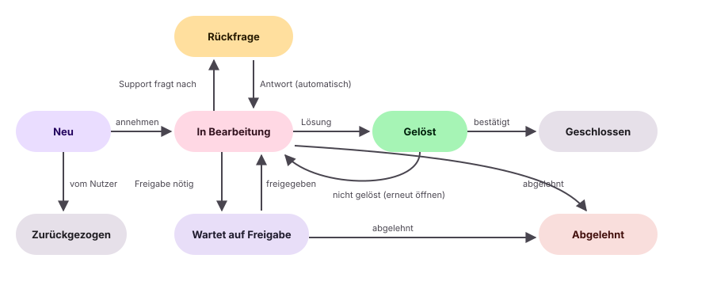

# Zweck und Zielgruppe

Dieses Handbuch beschreibt die Arbeit mit den geschützten Bereichen des IT-Service-Request-Portals:

* **Teil A – Support-Arbeitsbereich** für Mitarbeitende des First-Level-Supports / User Help Desk (Rolle `first-level`),
* **Teil B – Administration** für Portal-Administratorinnen und -Administratoren (Rolle `admin`).

Grundlegende Bedienung (Anmeldung, Oberfläche, Dark/Light Mode, Erstellen von Anfragen) ist im *Benutzerhandbuch* beschrieben.

## Rollen und Rechte

| Funktion | `user` | `first-level` | `admin` |
|---|:-:|:-:|:-:|
| Katalog nutzen, Requests erstellen, eigene Tickets | ✓ | ✓ | ✓ |
| Support-Queue, alle Tickets einsehen | – | ✓ | ✓ |
| Tickets annehmen/zuweisen, Priorität, Status | – | ✓ | ✓ |
| Interne Notizen, Standardlösungen anwenden | – | ✓ | ✓ |
| Abgeschlossene/abgelehnte Tickets wiedereröffnen | – | – | ✓ |
| Katalog, Formulare, Kategorien | – | – | ✓ |
| Status, Workflow, SLA, Standardlösungen pflegen | – | – | ✓ |
| Rollenübersicht, Audit-Log, Systemansicht | – | – | ✓ |

Rollen werden ausschließlich in **Keycloak** über Gruppen vergeben (`/Mitarbeitende`, `/IT-UHD`, `/IT-Portal-Admins`). Das Portal prüft jede Aktion **serverseitig**; ausgeblendete Schaltflächen sind keine Sicherheitsmaßnahme, sondern Komfort.

::: warning
**Pflicht für Support und Administration:** Zwei-Faktor-Authentisierung (TOTP-App, z. B. FreeOTP, Microsoft/Google Authenticator). Keycloak fordert die Einrichtung beim ersten Login an. Zugangsdaten und Authenticator-Gerät dürfen nicht weitergegeben werden.
:::

# Teil A – Support-Arbeitsbereich

## Aufbau der Support-Queue

Den Arbeitsbereich öffnen Sie über **Support** in der Navigation.

**Kennzahlen (oben):**

| Kachel | Bedeutung |
|---|---|
| Neu | Tickets im Status *Neu* |
| Nicht zugewiesen | Neue Tickets ohne Bearbeiter/in |
| Mir zugewiesen | Ihre offenen Tickets |
| SLA überschritten | Offene Tickets, deren Lösungsfrist abgelaufen ist |
| Kritisch offen | Offene Tickets mit Priorität *Kritisch* |
| Gelöst (7 Tage) | In den letzten 7 Tagen gelöste Tickets |

**Schnellfilter:** *Nicht zugewiesen*, *Mir zugewiesen*, *SLA überschritten* (erneutes Klicken hebt den Filter auf).

**Werkzeugleiste:** Ansicht (*Offen / Abgeschlossen / Alle*), Suche (Ticketnummer, Titel, Name der anfragenden Person), Filter nach Priorität, Kategorie und Bearbeiter/in, Sortierung (*Priorität*, *SLA-Fälligkeit*, *Neueste*, *Älteste*, *Zuletzt aktualisiert*).

::: tip
Empfohlene Arbeitsweise zu Schichtbeginn: Sortierung **„Nach SLA-Fälligkeit“**, Schnellfilter **„Nicht zugewiesen“** – so werden die dringendsten Tickets zuerst sichtbar. Filter bleiben in der Adresszeile erhalten und können als Lesezeichen gespeichert werden.
:::

## Bearbeitungsablauf



### 1. Sichten und annehmen

1. Ticket in der Queue öffnen.
2. Angaben prüfen (Formularfelder, Hinweise, Freigabeperson, Kostenstelle).
3. Im Bereich **Bearbeitung** auf **„Mir zuweisen“** klicken oder eine Person im Feld *Zugewiesen an* wählen.

Ein Ticket im Status *Neu* wechselt bei der Zuweisung **automatisch** auf *In Bearbeitung*. Die erste öffentliche Nachricht an die anfragende Person setzt den Zeitpunkt der **Erstreaktion** (SLA-Reaktionszeit).

### 2. Priorisieren

Die Priorität wird beim Anlegen aus dem Katalogeintrag übernommen und bei „viele betroffen“ bzw. „kann nicht weiterarbeiten“ automatisch auf *Hoch* angehoben. Passen Sie die Priorität bei Bedarf im Feld **Priorität** an – die SLA-Fristen werden ab Erstellungszeitpunkt neu berechnet.

| Priorität | Typische Kriterien | Reaktion | Lösung |
|---|---|---|---|
| Kritisch | Betriebsunterbrechung, viele Personen, Sicherheitsvorfall | 30 min (24/7) | 4 h |
| Hoch | Einzelperson kann nicht arbeiten, wichtige Termine | 1 h | 8 h |
| Mittel | Standardanfrage | 4 h | 40 h |
| Niedrig | Planbar, Komfort | 8 h | 120 h |

*Standardwerte; Zeiten in Geschäftszeiten (Mo–Fr 08–17 Uhr), sofern nicht anders konfiguriert.*

### 3. Rückfragen stellen

1. Im Bereich **Status ändern** auf **Rückfrage** klicken.
2. Im Dialog die **Rückfrage formulieren** (Pflichtfeld) und bestätigen.

Die anfragende Person sieht ein Hinweisbanner. Sobald sie antwortet, geht das Ticket **automatisch** zurück auf *In Bearbeitung*.

### 4. Freigaben

Für Katalogeinträge mit Kennzeichen *Freigabe erforderlich* (z. B. Notebooks, Berechtigungen):

1. Status **Wartet auf Freigabe** setzen (optional mit Kommentar).
2. Freigabe bei der im Formular genannten Person einholen (gemäß Freigabeprozess, z. B. E-Mail mit Ticketnummer).
3. Ergebnis als **interne Notiz** dokumentieren (wer, wann, Kanal).
4. Status auf **In Bearbeitung** (freigegeben) oder **Abgelehnt** (mit Begründung) setzen.

::: warning
Bei **Berechtigungen** immer prüfen: Ist die Freigabeperson tatsächlich ressourcenverantwortlich? Ist eine **Befristung** gesetzt? Entspricht die Berechtigungsstufe dem Minimum (Least Privilege)? Zweifelsfälle an den Second Level bzw. die Ressourcenverantwortlichen eskalieren.
:::

### 5. Kommunikation und interne Notizen

* **Öffentliche Nachricht:** sichtbar für die anfragende Person.
* **Interne Notiz:** Schalter *Interne Notiz* aktivieren – nur für Support/Admin sichtbar, im Verlauf gelb gestrichelt markiert. Nutzen Sie interne Notizen für technische Details, Freigabenachweise und Übergaben.

::: info
Notieren Sie **keine Passwörter, Einmalcodes oder vollständigen personenbezogenen Daten Dritter** in Tickets – auch nicht intern. Schreiben Sie sachlich: Tickets können im Rahmen von Auskunftsersuchen (Art. 15 DSGVO) offengelegt werden.
:::

### 6. Lösen – mit oder ohne Standardlösung

* **Standardlösung:** Im Feld *Standardlösung anwenden* einen Textbaustein wählen und **Anwenden** klicken. Der Text wird als Nachricht gesendet, das Ticket wird *Gelöst* und – falls noch nicht geschehen – Ihnen zugewiesen.
* **Individuelle Lösung:** Status **Gelöst** wählen und im Dialog die Lösung beschreiben.

Die anfragende Person kann die Lösung **bestätigen** (→ *Geschlossen*) oder das Ticket **erneut öffnen** (→ *In Bearbeitung*). Gelöste, nicht bestätigte Tickets schließen Sie nach Ablauf der vereinbarten Frist (Standard: 5 Arbeitstage) über **Geschlossen**.

### 7. Ablehnen

Status **Abgelehnt** mit verständlicher Begründung und ggf. Alternative (z. B. „Bitte Standardmodell beantragen“). Abgelehnte Tickets können nur Administratoren wieder öffnen.

## Gleichzeitige Bearbeitung (Konflikte)

Jedes Ticket besitzt eine Versionsnummer. Ändert eine andere Person das Ticket zwischen Ihrem Laden und Ihrer Aktion, erscheint die Meldung **„Der Datensatz wurde zwischenzeitlich geändert“** und die Ansicht wird neu geladen. Prüfen Sie den Verlauf und wiederholen Sie die Aktion bei Bedarf.

## Eskalation

| Situation | Maßnahme |
|---|---|
| SLA-Lösungsfrist droht zu reißen | Priorität prüfen, Teamleitung informieren, ggf. an Second Level übergeben (Zuweisung + interne Notiz) |
| Sicherheitsvorfall erkennbar (Phishing, Schadsoftware, Kontomissbrauch, Datenabfluss) | Priorität **Kritisch**, sofort CERT/ISB nach Notfallprozess informieren (siehe *Infosicherheitskonzept*), keine Beweise verändern |
| Datenschutzvorfall (z. B. Fehlversand personenbezogener Daten) | Unverzüglich Datenschutzkoordination informieren (72-h-Frist nach Art. 33 DSGVO) |
| Portal fehlerhaft / nicht erreichbar | Betriebsteam gemäß *Betriebskonzept* (Eskalationsmatrix) |

# Teil B – Administration

Den Admin-Bereich öffnen Sie über **Admin** in der Navigation. Er gliedert sich in Registerkarten. **Jede Änderung wird im Audit-Log protokolliert** (wer, wann, was, vorher/nachher-Kennzahlen).

## Übersicht

Zeigt Kennzahlen (Tickets gesamt/offen, bekannte Benutzer, aktive Katalogeinträge, Audit-Einträge), Systeminformationen (Portalversion, Node.js, Datenbankversion, angewandte Migrationen, Laufzeit) und die aktiven **Aufbewahrungsfristen**. Über **Übergreifende Ticketverwaltung** gelangen Sie in die Support-Queue mit Ansicht *Alle*.

## Katalog & Formulare

### Kategorien

Tabelle aller Kategorien mit ID, Name, Beschreibung, Reihenfolge und Aktiv-Status. Über **+ Kategorie** bzw. das Stiftsymbol werden Kategorien angelegt/bearbeitet.

* **ID:** nur Kleinbuchstaben, Ziffern und Bindestrich (2–40 Zeichen); nach Verwendung nicht ändern.
* **Inaktiv** gesetzte Kategorien verschwinden für Nutzer samt ihrer Einträge; bestehende Tickets bleiben unverändert.

### Katalogeinträge

Über **Neuer Eintrag** oder das Stiftsymbol öffnen Sie den Editor:

| Feld | Bedeutung |
|---|---|
| Name, Beschreibung | Anzeige im Katalog |
| Kategorie | Zuordnung |
| Standardpriorität | Startpriorität neuer Tickets |
| Reihenfolge | Sortierung innerhalb der Kategorie |
| Freigabe erforderlich | Kennzeichnung im Katalog; steuert den Prozess *Wartet auf Freigabe* |
| Schnellzugriff | Anzeige auf der Startseite |
| Aktiv | Sichtbarkeit im Katalog |
| Formulardefinition (JSON) | Felder des geführten Formulars |

### Formulardefinition

Ein Formular besteht aus einer Liste `fields` (max. 30 Felder):

```json
{
  "fields": [
    { "name": "model", "label": "Modell", "type": "select", "required": true,
      "options": [ { "value": "standard-14", "label": "Standard 14\"" } ] },
    { "name": "costCenter", "label": "Kostenstelle", "type": "text",
      "required": true, "maxLength": 10, "pattern": "^[0-9]{3,10}$" },
    { "name": "quantity", "label": "Anzahl", "type": "number", "min": 1, "max": 4 },
    { "name": "validUntil", "label": "Befristet bis", "type": "date", "required": true,
      "help": "Berechtigungen werden befristet vergeben" },
    { "name": "justification", "label": "Begründung", "type": "textarea",
      "required": true, "maxLength": 2000 }
  ]
}
```

| Typ | Zusätzliche Attribute | Hinweis |
|---|---|---|
| `text` | `maxLength` (≤ 500), `pattern` | Einzeilig |
| `textarea` | `maxLength` (≤ 5000) | Mehrzeilig |
| `email` | `maxLength` | Formatprüfung |
| `number` | `min`, `max` | Zahl |
| `date` | – | ISO-Datum |
| `checkbox` | – | Ja/Nein |
| `select` | `options` (1–50, `value`: a–z, 0–9, `-`, `_`) | Auswahlliste |

Gemeinsame Attribute: `name` (eindeutig, Buchstabe am Anfang, max. 40 Zeichen), `label`, `required`, `help`.

::: info
**Sicherheit:** Das Backend validiert jede Formulardefinition gegen ein Meta-Schema. Unbekannte Attribute, doppelte Feldnamen, ungültige reguläre Ausdrücke sowie **ReDoS-anfällige Muster** (verschachtelte Quantoren wie `(a+)+`) werden abgelehnt. Eingaben der Nutzer werden serverseitig strikt gegen das Formular geprüft; unbekannte Felder werden verworfen.
:::

::: warning
Änderungen an Formularen wirken nur auf **neue** Tickets. Für bestehende Tickets werden gespeicherte Werte mit der aktuellen Definition angezeigt – benennen Sie Felder (`name`) daher nicht um, sondern legen Sie bei grundlegenden Änderungen einen neuen Eintrag an und deaktivieren Sie den alten.
:::

## Status & Workflow

### Status bearbeiten

Für jeden Status können **Anzeigename**, **Beschreibung** und **Farbrolle** (neutral, primary, secondary, tertiary, success, warning, error) angepasst werden. Die technischen Codes und die Eigenschaft *Endstatus* sind fest, da Fristen- und Löschlogik darauf aufbauen.

### Statusübergänge

Die Matrix definiert, welche Rolle von welchem Ausgangsstatus (Zeile) in welchen Zielstatus (Spalte) wechseln darf. Rolle über die Segmentschaltfläche oben wählen, Häkchen setzen/entfernen, **Workflow speichern**.

* Die Rolle **Mitarbeitende** gilt nur für **eigene** Tickets (z. B. *Neu → Zurückgezogen*, *Gelöst → Geschlossen*).
* Schutzregel: Mindestens ein Übergang aus *Neu* für Support/Admin muss bestehen bleiben.
* Die automatische Rückführung *Rückfrage → In Bearbeitung* bei einer Antwort der anfragenden Person ist systemseitig hinterlegt.

## SLA

Je Priorität: Bezeichnung, Reaktionszeit, Lösungszeit (Minuten) und *Nur Geschäftszeiten*. Die Lösungszeit muss mindestens der Reaktionszeit entsprechen. Änderungen gelten für neue bzw. neu priorisierte Tickets. Abstimmung mit dem Service-Level-Management ist vor Änderungen erforderlich.

## Standardlösungen

Textbausteine für häufige Lösungen. Felder: Titel, Kategorie (oder *alle*), Text an die anfragende Person, Aktiv. Inaktive Bausteine stehen im Support nicht mehr zur Auswahl. Formulieren Sie Bausteine so, dass sie ohne Anpassung verständlich sind.

## Rollen

Die Seite zeigt die **erwarteten Rollen** mit zugehörigen Keycloak-Gruppen, die Anzahl der Personen je Rolle und eine Liste aller bisher angemeldeten Personen mit ihren zuletzt im Token gesehenen Rollen. Automatische **Warnungen** weisen hin auf:

* fehlende Administratoren,
* mehr als fünf Administratoren (Least-Privilege prüfen),
* Administratoren, die länger als 90 Tage inaktiv sind (Rezertifizierung).

Rollenänderungen erfolgen in Keycloak (Admin-Konsole, nur aus dem Admin-Netz erreichbar): **Benutzer → Gruppen → Gruppe beitreten/verlassen**. Die neue Rolle wirkt ab dem nächsten Token (spätestens nach 5 Minuten bzw. nach erneuter Anmeldung).

::: tip
**Quartalsweise Rezertifizierung:** Exportieren Sie die Rollenliste, lassen Sie sie von den Führungskräften bestätigen und entfernen Sie nicht mehr benötigte Gruppenmitgliedschaften in Keycloak. Dokumentieren Sie den Abschluss als Ticket.
:::

## Audit-Log

Das Audit-Log protokolliert sicherheits- und prüfungsrelevante Ereignisse, u. a.:

| Aktion | Auslöser |
|---|---|
| `ticket.create`, `ticket.status`, `ticket.assign`, `ticket.priority`, `ticket.comment`, `ticket.solution` | Ticketbearbeitung |
| `admin.catalog.*`, `admin.category.upsert`, `admin.workflow.update`, `admin.status.update`, `admin.sla.update`, `admin.solution.*` | Administration |
| `authz.denied`, `auth.denied` | Zugriff ohne erforderliche Rolle |
| `admin.audit.verify`, `system.retention` | Integritätsprüfung, Löschlauf |

**Filter:** Aktion (Präfix, z. B. `admin.`), Person, Objekt-ID (z. B. Ticketnummer `SR-001234`), Ergebnis (*Erfolg*, *Verweigert*, *Fehler*).

**Integrität prüfen:** Jeder Eintrag ist per SHA-256 mit seinem Vorgänger verkettet. Die Prüfung berechnet die Kette neu. Ergebnis *Manipulationsverdacht* ist ein **Sicherheitsvorfall** – sofort nach Notfallprozess melden und keine weiteren Änderungen am System vornehmen.

::: info
Audit-Einträge sind in der Datenbank **unveränderlich** (keine Änderungs- oder Löschrechte für die Anwendung). Sie werden ausschließlich durch den automatischen Löschlauf nach Ablauf der Aufbewahrungsfrist entfernt; IP-Adressen werden vorher gesondert gelöscht.
:::

## Keycloak-Administration (Kurzreferenz)

| Aufgabe | Ort in Keycloak (Realm `itportal`) |
|---|---|
| Rolle vergeben/entziehen | Users → Benutzer → Groups |
| Konto sperren | Users → Benutzer → *Enabled* aus |
| Passwort zurücksetzen | Users → Benutzer → Credentials → Reset password (temporär) |
| MFA zurücksetzen | Users → Benutzer → Credentials → OTP löschen |
| Sitzungen beenden | Users → Benutzer → Sessions → Sign out |
| Anmeldeereignisse prüfen | Events → User events / Admin events |
| Token-Laufzeiten, Passwortrichtlinie | Realm settings → Tokens / Authentication → Policies |

::: warning
Die Keycloak-Admin-Konsole ist nur aus dem in `ADMIN_ALLOW_CIDR` definierten Admin-Netz erreichbar. Verwenden Sie für Keycloak personalisierte Admin-Konten im Master-Realm mit MFA; das Bootstrap-Konto wird nach Inbetriebnahme gelöscht.
:::

# Checklisten

## Schichtbeginn (Support)

- [ ] Kennzahlen prüfen: *SLA überschritten*, *Kritisch offen*
- [ ] Nicht zugewiesene Tickets nach SLA-Fälligkeit sichten und verteilen
- [ ] Eigene Tickets mit Status *Rückfrage* > 3 Arbeitstage nachfassen
- [ ] Gelöste Tickets > 5 Arbeitstage schließen

## Monatlich (Administration)

- [ ] Audit-Log: Integrität prüfen, Ereignisse `authz.denied` sichten
- [ ] Katalog: veraltete Einträge deaktivieren, Formulare prüfen
- [ ] Standardlösungen aktualisieren
- [ ] SLA-Erfüllung auswerten (mit Service-Level-Management)

## Quartalsweise (Administration)

- [ ] Rollen-Rezertifizierung (siehe Abschnitt Rollen)
- [ ] Keycloak: inaktive Konten, Admin-Konten, Clients und Redirect-URIs prüfen
- [ ] Restore-Test aus Backup (gemeinsam mit Betrieb, siehe *Betriebskonzept*)
