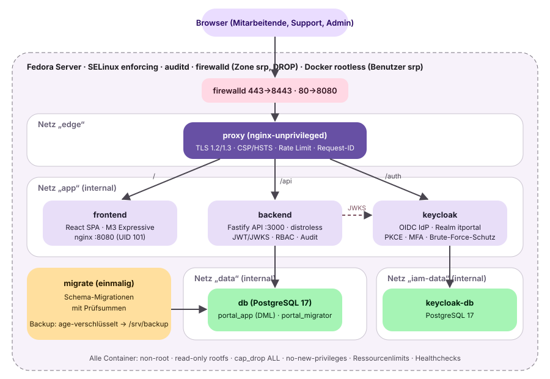

# Einleitung

## Zweck

Dieses Informationssicherheitskonzept (ISK) beschreibt die Sicherheitsarchitektur des IT-Service-Request-Portals (nachfolgend *Portal*), stellt den Schutzbedarf fest, analysiert Gefährdungen und Risiken und dokumentiert die umgesetzten technischen und organisatorischen Maßnahmen (TOM). Es dient als Grundlage für Freigabe, Betrieb und Revision.

Methodisch orientiert sich das Konzept an der **BSI-Standard-200-2-Vorgehensweise (Standard-Absicherung)** mit ergänzender Risikoanalyse nach **BSI-Standard 200-3**. Die Maßnahmen werden zusätzlich den Kontrollen aus **NIST SP 800-53 Rev. 5** und den Funktionen des **NIST Cybersecurity Framework (CSF) 2.0** zugeordnet. Architekturleitbild sind die **Zero-Trust-Prinzipien** nach NIST SP 800-207.

## Geltungsbereich

| Im Geltungsbereich | Nicht im Geltungsbereich |
|---|---|
| Portal-Anwendung (Frontend, Backend-API), Datenbank, Reverse Proxy | Endgeräte der Nutzenden (eigenes Client-Konzept) |
| Keycloak-Instanz für den Realm `itportal` inkl. Datenbank | Unternehmensverzeichnis (AD/LDAP) als ggf. angebundene Quelle |
| Fedora-Server (Host), Container-Laufzeit (rootless Docker) | Netzinfrastruktur außerhalb des Servers (Router, Core-Firewall) |
| Backups, Protokollierung, Betriebsprozesse des Portals | Nachgelagerte Fachsysteme (Inventar, Lizenz, IAM-Provisionierung) |

## Verantwortlichkeiten

| Rolle | Verantwortung |
|---|---|
| Informationssicherheitsbeauftragte/r (ISB) | Freigabe und Fortschreibung dieses Konzepts, Risikoakzeptanz, Sicherheitsvorfälle |
| Anwendungsverantwortliche/r (Service Owner) | Fachliche Verantwortung, Rollenkonzept, Rezertifizierung |
| IT-Betrieb | Server, Container, Backup, Patchmanagement, Monitoring |
| Entwicklung | Sichere Entwicklung, Abhängigkeits- und Schwachstellenmanagement |
| IAM-Team | Keycloak, Gruppen-/Rollenvergabe, MFA |
| Datenschutzbeauftragte/r (DSB) | Datenschutzkonzept, Beratung, Kontrolle |

# Strukturanalyse

## Systemarchitektur

Das Portal besteht aus sieben Containern, die rootless unter dem Dienstkonto `srp` auf einem gehärteten Fedora Server laufen. Nur der Reverse Proxy ist von außen erreichbar; alle übrigen Dienste befinden sich in internen Docker-Netzen ohne Außenverbindung (`internal: true`).

## Zielobjekte

| ID | Zielobjekt | Beschreibung |
|---|---|---|
| A1 | Geschäftsprozess *IT-Anfragemanagement* | Beantragung, Freigabe, Bearbeitung von IT-Leistungen |
| A2 | Informationen | Ticketinhalte, Formularangaben (inkl. Kostenstellen, Berechtigungsanträge), Kommentare, Benutzerprofile, Audit-Log |
| S1 | Frontend (SPA) | React-Anwendung, ausgeliefert durch nginx (UID 101) |
| S2 | Backend-API | Node.js/Fastify, distroless, UID 65532 |
| S3 | Portal-Datenbank | PostgreSQL 17, getrennte Rollen `portal_migrator` / `portal_app` |
| S4 | Identity Provider | Keycloak 26 (OIDC), eigene PostgreSQL-Instanz |
| S5 | Reverse Proxy | nginx-unprivileged, TLS-Terminierung, Security-Header |
| H1 | Server | Fedora Server, SELinux enforcing, firewalld, auditd |
| N1 | Netzsegmente | `edge`, `app`, `data`, `iam-data` (Docker) und Server-LAN |
| B1 | Datensicherung | age-verschlüsselte Dumps, Offline-Schlüssel |

## Kommunikationsbeziehungen

| Von | Nach | Protokoll | Schutz |
|---|---|---|---|
| Browser | Proxy | HTTPS 443 | TLS 1.2/1.3 (BSI TR-02102-2), HSTS |
| Proxy | Frontend / Backend / Keycloak | HTTP (internes Netz `app`) | Netzsegmentierung, kein Außenzugriff |
| Backend | Keycloak (JWKS) | HTTP intern | nur Abruf öffentlicher Schlüssel, feste URL |
| Backend / Migrator | Portal-DB | PostgreSQL (Netz `data`) | SCRAM-SHA-256, Least-Privilege-Rollen |
| Keycloak | Keycloak-DB | PostgreSQL (Netz `iam-data`) | SCRAM-SHA-256, separates Netz |
| Admin-Arbeitsplatz | Server | SSH 22 | nur Admin-Netz, Public Key, TR-02102-4 |

# Schutzbedarfsfeststellung

Schutzbedarfskategorien nach BSI 200-2: **normal**, **hoch**, **sehr hoch**.

| Zielobjekt | Vertraulichkeit | Integrität | Verfügbarkeit | Begründung |
|---|---|---|---|---|
| A1 Anfrageprozess | normal | hoch | normal | Fehlerhafte Freigaben/Berechtigungen führen zu Rechteausweitung; Ausfall von 1 Arbeitstag tolerierbar (Telefon-Fallback) |
| A2 Ticketinhalte | hoch | hoch | normal | Personenbezogene Daten, Kostenstellen, Hinweise auf Systeme/Berechtigungen; Manipulation von Berechtigungsanträgen kritisch |
| A2 Audit-Log | hoch | **sehr hoch** | normal | Beweiswert, Revisionssicherheit, Nachweis von Freigaben |
| S4 Keycloak | hoch | **sehr hoch** | hoch | Kompromittierung erlaubt Identitätsübernahme für alle Rollen |
| S2/S3 Backend & DB | hoch | hoch | normal | Vererbung von A2 (Maximumprinzip) |
| S5 Proxy | normal | hoch | normal | Vertrauensanker TLS, Header-Policies |
| H1 Server | hoch | hoch | normal | Kumulationseffekt aller Dienste |
| B1 Backups | hoch | hoch | normal | Enthalten vollständige Datenbestände |

**Ergebnis:** Für Integrität von Keycloak und Audit-Log besteht **sehr hoher** Schutzbedarf; daher wird ergänzend eine Risikoanalyse (Kap. 5) durchgeführt. Für die übrigen Objekte genügt die Standard-Absicherung, die durch die Maßnahmen in Kap. 6 übererfüllt wird.

# Modellierung nach IT-Grundschutz

| Baustein | Zielobjekte | Umsetzung (Kurz) |
|---|---|---|
| ISMS.1 Sicherheitsmanagement | Gesamt | Dieses ISK, Rollen, jährliche Überprüfung |
| ORP.4 Identitäts- und Berechtigungsmanagement | S4, A1 | Keycloak-Gruppen → Rollen, MFA, Rezertifizierung, befristete Berechtigungen |
| CON.1 Kryptokonzept | Gesamt | TLS gem. TR-02102-2, SSH gem. TR-02102-4, Crypto-Policy, age für Backups |
| CON.2 Datenschutz | A2 | Datenschutzkonzept, Lösch-/Anonymisierungsroutinen |
| CON.3 Datensicherungskonzept | B1 | Tägliche verschlüsselte Backups, Restore-Tests |
| CON.8 Software-Entwicklung | S1, S2 | Typisierte Sprache, Validierung, Tests, Abhängigkeitsprüfung |
| OPS.1.1.3 Patch- und Änderungsmanagement | H1, S* | dnf-automatic, Image-Rebuilds, Change-Prozess |
| OPS.1.1.5 Protokollierung | Gesamt | auditd, journald (FSS), Audit-Log mit Hash-Kette, strukturierte JSON-Logs |
| APP.3.1 Webanwendungen und Webservices | S1, S2 | AuthN/AuthZ serverseitig, Input-Validierung, Security-Header |
| APP.3.2 Webserver | S5 | nginx gehärtet, TLS, Rate Limits |
| APP.4.3 Relationale Datenbanken | S3 | Rollen-Trennung, SCRAM, keine Superuser-Nutzung durch App |
| SYS.1.1 Allgemeiner Server / SYS.1.3 Server unter Linux | H1 | Härtungsskripte, SELinux, Minimalinstallation |
| SYS.1.6 Containerisierung | S1–S5 | rootless, non-root, read-only, cap_drop, Netztrennung, Secrets |
| NET.3.2 Firewall | H1, N1 | firewalld Default DROP, Port-Forwarding, Admin-Netz |
| DER.1 Detektion von sicherheitsrelevanten Ereignissen | Gesamt | Log-Weiterleitung an SIEM, Alarmierung |
| DER.2.1 Behandlung von Sicherheitsvorfällen | Gesamt | Incident-Playbooks (Kap. 8) |
| DER.4 Notfallmanagement | Gesamt | Wiederanlauf, Restore, Eskalation (siehe Betriebskonzept) |

# Gefährdungs- und Risikoanalyse

Bewertung nach BSI 200-3: Eintrittshäufigkeit (selten / mittel / häufig / sehr häufig) × Schadenshöhe (vernachlässigbar / begrenzt / beträchtlich / existenzbedrohend). Angegeben ist das **Restrisiko nach Maßnahmen**.

| Nr. | Gefährdung (elementar) | Szenario | Maßnahmen (Auswahl) | Restrisiko |
|---|---|---|---|---|
| R1 | G 0.36 Identitätsdiebstahl | Phishing von Zugangsdaten eines Support-/Admin-Kontos | MFA (TOTP) Pflicht für Support/Admin, Brute-Force-Schutz, kurze Token-Laufzeit, Anmeldeereignisse | gering |
| R2 | G 0.32 Missbrauch von Berechtigungen | Support genehmigt eigene oder unberechtigte Berechtigungsanträge | Freigabe durch Ressourcenverantwortliche, Befristung, Audit-Log, Rezertifizierung | mittel (organisatorisch) |
| R3 | G 0.23 Unbefugtes Eindringen | Ausnutzung von Broken Access Control (IDOR) | Rollenprüfung je Endpunkt, Eigentümerprüfung, 404 statt 403, Tests | gering |
| R4 | G 0.28 Software-Schwachstellen | SQL-Injection, XSS, Deserialisierung | Parametrisierte Queries, Zod-Validierung (strict), React-Escaping, CSP ohne `unsafe-inline` | gering |
| R5 | G 0.20 Informationen/Produkte aus unzuverlässiger Quelle | Kompromittierte npm-Abhängigkeit / Container-Image | Lockfiles + `npm ci --ignore-scripts`, `npm audit`, offizielle Basis-Images, distroless, Image-Scan | mittel |
| R6 | G 0.40 Verhinderung von Diensten | Request-Flut, Login-Brute-Force | nginx `limit_req`/`limit_conn`, API-Rate-Limit, Keycloak Brute-Force-Schutz, Ressourcenlimits | gering |
| R7 | G 0.22 / G 0.46 Manipulation / Integritätsverlust | Nachträgliche Änderung von Audit-Einträgen | Append-only (Trigger + fehlende Rechte), Hash-Kette, Integritätsprüfung, Log-Export an SIEM | gering |
| R8 | G 0.15 Abhören | Mitschnitt im Netz | TLS 1.2/1.3, HSTS, interne Netze ohne Außenzugang | gering |
| R9 | G 0.19 Offenlegung schützenswerter Informationen | Tokens/Passwörter in Logs | Log-Redaction (Authorization/Cookie), keine Query-Strings im Proxy-Log, Hinweis „keine Passwörter“ im UI | gering |
| R10 | G 0.30 Unberechtigte Administration | Zugriff auf Keycloak-Admin-Konsole aus dem Intranet | Admin-Konsole/Master-Realm nur aus `ADMIN_ALLOW_CIDR`, personalisierte Admins mit MFA | gering |
| R11 | G 0.45 Datenverlust | Defekt/Fehlbedienung/Ransomware | Tägliche, verschlüsselte Backups, Offline-Schlüssel, Restore-Tests, Rotation | gering |
| R12 | G 0.21 Manipulation von Software | Container-Escape, Rechteausweitung auf dem Host | rootless Docker, non-root, `no-new-privileges`, `cap_drop: ALL`, SELinux-Labels, read-only | gering |
| R13 | G 0.18 Fehlplanung / fehlende Anpassung | Unsichere Konfigurationsänderung (z. B. Workflow, Formular-Regex) | Meta-Schema-Validierung, ReDoS-Schutz, Audit, Vier-Augen-Prinzip für Admin-Änderungen | gering |
| R14 | G 0.37 Abstreiten von Handlungen | Bearbeiter/in bestreitet Statusänderung | Personenbezogenes Audit-Log mit Request-ID und Zeitstempel, Hash-Kette | gering |
| R15 | G 0.29 Verstoß gegen Gesetze | Zu lange Speicherung personenbezogener Daten | Automatische Anonymisierung/Löschung (siehe Datenschutzkonzept) | gering |
| R16 | G 0.32 Missbrauch von Berechtigungen | Neues Benutzerkonto „wie Referenzperson“ übernimmt angesammelte Sonderrechte (Privilege Creep) | Pflichtbestätigung „gleiche Aufgaben“, Feld für Abweichungen, Freigabe durch Vorgesetzte, Prüfung der Referenzrechte durch Support, Befristung, Rezertifizierung | mittel (organisatorisch) |
| R17 | G 0.19 Offenlegung schützenswerter Informationen | Private Schlüssel werden für Zertifikatsanträge per Ticket übermittelt | Schlüsselerzeugung auf dem Zielsystem, nur CSR, deutliche Warnhinweise im Formular, Support löscht Schlüssel aus Tickets und meldet Vorfall | gering |
| R18 | G 0.23 Unbefugtes Eindringen | VPN-Zugang für Externe oder administrative Zugänge zu weitreichend | Eigener Katalogeintrag mit Zugangsart, Pflicht-Befristung, Freigabe, nur verwaltete Geräte, MFA | gering |
| R20 | G 0.36 Identitätsdiebstahl / G 0.30 Unberechtigte Nutzung | Missbrauch der Selbstregistrierung (Fremd- oder Massenkonten) | E-Mail-Bestätigung, Domain-Prüfung im Backend, nur Rolle `user`, Rate Limits auf Registrierungsendpunkt, Brute-Force-Schutz, Sperren im Admin-Bereich | gering |
| R21 | G 0.32 Missbrauch von Berechtigungen | Kompromittierung des Service-Accounts `portal-admin-api` (manage-users) | Secret nur im Backend (internes Netz), Client-Credentials ohne Browser-Flows, Token 120 s, nur Realm `itportal` (kein Master), Backend nutzt nur Gruppen der drei Portal-Rollen/Sperren, Audit jeder Änderung, Secret-Rotation | gering |
| R22 | G 0.31 Fehlerhafte Administration | Aussperren durch Entzug der letzten Admin-Rechte | Serverseitige Schutzregeln (keine Selbst-Herabstufung, letzter Admin geschützt), Notfall-Admin in Keycloak | gering |
| R19 | G 0.18 Fehlplanung | VMs in falschem Netzsegment (z. B. DMZ) oder ohne Backup/Monitoring | Pflichtangaben Netzsegment, Verantwortliche/r, Laufzeit; Prüfung durch Betrieb vor Bereitstellung | gering |

**Risikobehandlung:** Die mittleren Restrisiken R2, R5 und R16 werden durch organisatorische Maßnahmen (Kap. 7) weiter gesenkt und vom ISB im Rahmen der Freigabe akzeptiert.

# Technische Maßnahmen

## Identität, Authentisierung und Zugriff (Zero Trust)

| Maßnahme | Umsetzung | NIST 800-53 |
|---|---|---|
| Zentraler IdP | Keycloak-Realm `itportal`; keine lokalen Konten in der Anwendung | IA-2, AC-2 |
| Moderner Flow | OIDC Authorization Code Flow mit **PKCE (S256)**, öffentlicher Client ohne Secret, kein Implicit/Password Grant | IA-2, SC-23 |
| Token-Härtung | Access Token 5 min, SSO-Idle 30 min, max. 10 h, Refresh-Token-Rotation (`revokeRefreshToken`), Tokens nur im Browser-Speicher | AC-12, SC-23 |
| Token-Prüfung | Signatur via JWKS, `iss`, `aud=portal-api`, `azp=portal-frontend`, `exp/iat`, Algorithmus-Allowlist, 30 s Toleranz | IA-2, SC-13 |
| MFA | TOTP verpflichtend für Support/Admin (Required Action), optional für alle | IA-2(1), IA-2(2) |
| Passwortrichtlinie | ≥ 12 Zeichen, Komplexität, Historie 5, nicht Benutzername/E-Mail; Speicherung mit dem Keycloak-Hashverfahren (Argon2 bzw. PBKDF2) und erhöhten Iterationen | IA-5 |
| Brute-Force-Schutz | 5 Fehlversuche → progressive Sperre bis 15 min; zusätzlich nginx-Limit 10 req/min auf Login-Endpunkte | AC-7 |
| RBAC | Realm-Rollen `user`, `first-level`, `admin` über Gruppen; Allowlist im Backend; Prüfung **an jedem Endpunkt** | AC-3, AC-6 |
| Objektberechtigung | Nutzer sehen nur eigene Tickets; fremde IDs liefern 404 | AC-3 |
| Workflow-Durchsetzung | Statusübergänge aus DB-Tabelle je Rolle, serverseitig geprüft, verweigerte Versuche auditiert | AC-3, AU-2 |
| Admin-Pfade | `/auth/admin` und Master-Realm nur aus Admin-Netz | AC-17, SC-7 |
| Selbstregistrierung | Keycloak-Registrierung mit E-Mail-Bestätigung, Standardgruppe `/Mitarbeitende`, Zugriff nur mit bestätigter Adresse aus `ALLOWED_EMAIL_DOMAINS` (Backend), keine Vergabe privilegierter Rollen | AC-2, IA-8 |
| Rollenverwaltung | Admin-Oberfläche über Service-Account `portal-admin-api` (Client Credentials, Realm-beschränkt); sofortiges Beenden von Sitzungen bei Rechteentzug; Schutz vor Selbst-/Letzt-Admin-Herabstufung; Begründungspflicht im Audit | AC-2, AC-2(4), AC-6 |

## Anwendungssicherheit (OWASP Top 10)

| Risiko | Maßnahme |
|---|---|
| A01 Broken Access Control | `requireRole` je Route, IDOR-Schutz, Workflow-Matrix, 404 statt 403 bei fremden Objekten |
| A02 Cryptographic Failures | TLS-only, HSTS, keine Secrets im Code, Docker-Secrets, verschlüsselte Backups |
| A03 Injection | Ausschließlich parametrisierte SQL-Statements; Sortierung über Allowlist; LIKE-Escaping; strikte Zod-Schemas |
| A04 Insecure Design | Least Privilege (DB-Rollen, Container), Defense in Depth, optimistische Sperren gegen Race Conditions |
| A05 Security Misconfiguration | Security-Header, gehärtete Images, Fail-Secure-Konfigurationsprüfung beim Start |
| A06 Vulnerable Components | Lockfiles, `npm audit`, regelmäßige Image-Rebuilds, Basis-Images aus offiziellen Quellen |
| A07 Identification & Auth Failures | Keycloak, MFA, Brute-Force-Schutz, kurze Tokens |
| A08 Software & Data Integrity | Migrationen mit SHA-256-Prüfsummen, `npm ci --ignore-scripts`, Audit-Hash-Kette |
| A09 Logging & Monitoring Failures | Strukturierte Logs, Audit-Log, auditd, SIEM-Weiterleitung |
| A10 SSRF | Keine benutzergesteuerten ausgehenden Requests; JWKS-URL fest konfiguriert; interne Netze ohne Internet |

**Weitere Detailmaßnahmen:**

* **Input-Validierung:** Jeder Body, Query- und Pfadparameter wird mit `zod` *strict* validiert (unbekannte Felder → 400). Freitexte werden von Steuer- und Bidi-Zeichen bereinigt; Längen sind begrenzt (Body-Limit 64 KiB).
* **Dynamische Formulare:** Admin-definierte Formulare werden gegen ein Meta-Schema geprüft; reguläre Ausdrücke mit verschachtelten Quantoren (ReDoS) werden abgelehnt. Nutzereingaben werden serverseitig gegen das Formular validiert (Typ, Pflicht, Länge, Muster, Optionen, Pflichtbestätigungen). Bedingte Felder (`when`) werden serverseitig ausgewertet: Werte inaktiver Felder werden verworfen, Pflichtangaben nur bei erfüllter Bedingung gefordert; Bundles erzwingen mindestens eine Position (`requireOneOf`).
* **XSS:** React escaped alle Ausgaben; kein `dangerouslySetInnerHTML`. CSP: `default-src 'self'; script-src 'self'; style-src 'self'; object-src 'none'; base-uri 'none'; frame-ancestors 'none'`. Theme-Farben werden per CSSOM gesetzt (CSP-konform).
* **CSRF:** Die API authentisiert ausschließlich über den `Authorization: Bearer`-Header (keine Cookies) – klassisches CSRF ist damit nicht möglich. Zusätzlich prüft das Backend den `Origin`-Header bei schreibenden Methoden.
* **Path Traversal:** Die API bietet keine Dateioperationen; statische Dateien liefert nginx aus einem festen Verzeichnis, versteckte Dateien sind gesperrt. Datei-Uploads sind in Release 1.0 bewusst nicht implementiert.
* **Fehlerbehandlung:** Einheitliche Fehlerantworten ohne Stacktraces; interne Fehler nur mit Request-ID.
* **Rate Limiting:** nginx (20 req/s API, 10 req/min Login je IP) und Fastify (300 req/min global, 20 Ticket-Erstellungen/min).

## Transport- und Speicherverschlüsselung

| Bereich | Verfahren |
|---|---|
| Browser ↔ Proxy | TLS 1.2/1.3, nur AEAD-Suiten (AES-GCM), ECDHE mit secp384r1/prime256v1, Session-Tickets aus, HSTS 1 Jahr |
| Administration | SSH gemäß TR-02102-4: ECDH/DH-Gruppen ≥ 3072 bit, AES-GCM/CTR, HMAC-SHA2-ETM, RSA ≥ 3072 bit |
| Systemweit | Crypto-Policy `BSI` (sofern verfügbar) bzw. `DEFAULT:NO-SHA1` |
| Datenbank-Authentisierung | SCRAM-SHA-256 |
| Daten at rest | LUKS2-Volume für `/srv` (Docker-Volumes, Backups) |
| Backups | `age` (X25519/ChaCha20-Poly1305), privater Schlüssel offline im Tresor |
| Secrets | Docker-Secrets (Dateien, 0444 in 0700-Verzeichnis), `.env` 0600, nicht im Repository |
| Journal | Forward Secure Sealing (FSS) |

## Plattform- und Containerhärtung

* **Fedora Server:** Minimalinstallation, SELinux *enforcing*, firewalld Default DROP, sysctl-Härtung, Modul-Blacklist, `/tmp` und `/dev/shm` mit `noexec,nosuid,nodev`, Coredumps aus, AIDE, chrony, automatische Sicherheitsupdates, Root-Login gesperrt – automatisiert durch `fedora-hardening/` (Ansible/Bash) inkl. Prüfskript `verify.sh`.
* **Container:** Docker **rootless** (kein privilegierter Daemon), alle Prozesse non-root, `read_only` Root-FS mit tmpfs, `cap_drop: ALL`, `no-new-privileges`, PID-/CPU-/Speicherlimits, Healthchecks, Multi-Stage-Builds, distroless Runtime für das Backend (keine Shell).
* **Netze:** Nur `edge` hat Außenverbindung; `app`, `data`, `iam-data` sind `internal`. Datenbanken sind nicht vom Proxy erreichbar.
* **Datenbank:** App-Rolle ohne DDL, Audit-Log ohne UPDATE/DELETE; `statement_timeout` 15 s; Löschfunktion als `SECURITY DEFINER` mit Mindestfristen.

## Protokollierung und Überwachung

| Quelle | Inhalt | Ziel / Aufbewahrung |
|---|---|---|
| Portal-Audit-Log (DB) | Wer/Wann/Was/Ergebnis/Request-ID/IP für alle fachlichen und administrativen Änderungen sowie Zugriffsverweigerungen | DB, 365 Tage; IP 90 Tage; Hash-Kette |
| Backend-Log (JSON) | Requests (ohne Query/Token), Fehler, Audit-Kurzform | journald → SIEM |
| Proxy-Log (JSON) | Zugriffe mit Request-ID, Status, Laufzeit | journald → SIEM |
| Keycloak-Events | Login/Logout/Fehler, Admin-Events mit Details | Keycloak-DB 90 Tage, Export SIEM |
| auditd | Identitäten, sudo, SSH-Konfig, SELinux, Module, Zeit, Container, Portal-Secrets | `/var/log/audit`, SIEM |
| journald | Systemprotokolle, persistent, versiegelt | 180 Tage |

**Alarmierungsregeln (Empfehlung für SIEM):** gehäufte `authz.denied`, `LOGIN_ERROR`-Spitzen, Admin-Event in Keycloak außerhalb der Geschäftszeit, fehlgeschlagene Audit-Integritätsprüfung, AIDE-Abweichung, auditd-Schlüssel `srp-secrets`, `privileged-exec`, Container *unhealthy*.

# Organisatorische Maßnahmen

* **Rollen- und Rechtevergabe** nur über Antrag (Ticket) mit Freigabe der Führungskraft; Admin-Rolle zusätzlich durch ISB.
* **Quartalsweise Rezertifizierung** der Rollen `first-level` und `admin` (Rollenübersicht im Admin-Bereich).
* **Vier-Augen-Prinzip** für Änderungen an Workflow, SLA und Katalog mit Berechtigungsbezug (Change-Ticket + Freigabe).
* **Change-Management:** Updates von Images und Abhängigkeiten über Staging, Smoke-Test, Freigabe (siehe Betriebskonzept).
* **Schwachstellenmanagement:** wöchentliche Auswertung `npm audit` und Image-Scan (z. B. Trivy/Grype), Patch-SLA: kritisch 72 h, hoch 7 Tage.
* **Sichere Entwicklung:** Code-Review, Tests (Token-Validierung, Formularvalidierung, Workflow), kein Merge ohne grüne Pipeline, Secrets-Scanning.
* **Sensibilisierung:** Support-Mitarbeitende werden zu Social Engineering (z. B. vorgetäuschte Berechtigungsanträge) geschult.
* **Dienstleister:** Bei externer Unterstützung Verpflichtung auf Vertraulichkeit und ggf. AV-Vertrag.

# Notfall- und Incident-Handling

## Meldewege und Klassifikation

| Klasse | Beispiele | Reaktion |
|---|---|---|
| **P1 kritisch** | Kompromittierung Keycloak/Admin-Konto, Datenabfluss, manipuliertes Audit-Log, Ransomware | Sofort ISB/CERT + IT-Leitung, Krisenstab nach Bedarf, DSB bei Personenbezug |
| **P2 hoch** | Kompromittiertes Nutzerkonto, ausgenutzte Schwachstelle ohne Datenabfluss | ISB innerhalb 4 h |
| **P3 mittel** | Verdächtige Muster, fehlgeschlagene Angriffe | Analyse im nächsten Arbeitstag |

Bei Verletzung des Schutzes personenbezogener Daten: Information der/des DSB **unverzüglich**, Bewertung der Meldepflicht an die Aufsichtsbehörde binnen **72 Stunden** (Art. 33 DSGVO).

## Phasen (angelehnt an NIST SP 800-61)

1. **Vorbereitung:** Playbooks, Kontakte, Zugriff auf Logs/SIEM, Offline-Backups, Notfall-Admin-Konto (versiegelt).
2. **Erkennung & Analyse:** SIEM-Alarm/Meldung → Triage, Beweissicherung (Logs exportieren, Snapshots, `docker compose logs`, Audit-Export, `ausearch`).
3. **Eindämmung:** betroffene Konten sperren, Sitzungen beenden, Proxy-Wartungsmodus oder Netztrennung, Rotation kompromittierter Secrets.
4. **Beseitigung:** Ursache beheben (Patch, Konfiguration), Images neu bauen, ggf. Server neu aufsetzen (Infrastructure as Code).
5. **Wiederherstellung:** Restore aus geprüftem Backup, Integritätsprüfung (Audit-Kette, AIDE), Smoke-Test, Freigabe durch ISB.
6. **Nachbereitung:** Lessons Learned, Anpassung dieses Konzepts, Maßnahmenverfolgung.

## Playbooks (Kurzform)

| Szenario | Sofortmaßnahmen |
|---|---|
| Admin-/Support-Konto kompromittiert | Konto in Keycloak deaktivieren → *Sessions: Sign out* → OTP zurücksetzen → Audit-Log nach `actor` filtern, Änderungen bewerten/rückgängig machen |
| Token-Signaturschlüssel kompromittiert | Keycloak: neuen Schlüssel erzeugen, alten deaktivieren (*Realm settings → Keys*), alle Sitzungen beenden |
| Audit-Integrität verletzt | System einfrieren (keine Änderungen), DB-Dump + Logs sichern, mit SIEM-Kopie abgleichen, P1 |
| Schwachstelle in Abhängigkeit (kritisch) | Bewertung Ausnutzbarkeit, Patch/Workaround (z. B. Proxy-Regel), Rebuild + Deploy, Nachweis im Change |
| DoS / Lastspitze | Rate Limits verschärfen, Upstream-Filter, Quell-IPs sperren (firewalld rich rule) |
| Ransomware / Server-Kompromittierung | Netztrennung, forensisches Image, Neuaufbau via Härtungsskript, Restore aus Offline-Backup, Rotation aller Secrets |
| Keycloak nicht verfügbar | Telefon-Fallback Service Desk, Wiederanlauf nach Betriebskonzept |

## Secret-Rotation

| Secret | Vorgehen |
|---|---|
| DB-Passwörter | neues Secret in `secrets/`, `ALTER ROLE … PASSWORD` als Superuser, `docker compose up -d` |
| Keycloak-DB-Passwort | `.env` + `ALTER ROLE` in keycloak-db, Neustart Keycloak |
| TLS-Schlüssel | neues Zertifikat aus PKI, Austausch in `proxy/certs`, Neustart Proxy, altes Zertifikat sperren |
| Backup-Schlüssel (age) | neues Schlüsselpaar, `BACKUP_AGE_RECIPIENT` anpassen; alter privater Schlüssel bleibt für Bestandsbackups im Tresor |

# Zuordnung zu NIST CSF 2.0

| Funktion | Kategorie (Auswahl) | Umsetzung im Portal |
|---|---|---|
| **GOVERN (GV)** | GV.RR Rollen & Verantwortung, GV.PO Richtlinien, GV.SC Lieferkette | Rollen in Kap. 1.3, dieses ISK, Lockfiles/Basis-Images/Abhängigkeitsprüfung |
| **IDENTIFY (ID)** | ID.AM Assets, ID.RA Risikobewertung | Strukturanalyse (Kap. 2), Risikoanalyse (Kap. 5) |
| **PROTECT (PR)** | PR.AA Identität/Authentisierung/Zugriff, PR.DS Datensicherheit, PR.PS Plattformsicherheit, PR.IR Infrastrukturresilienz | Keycloak/MFA/RBAC, TLS/LUKS/age, Härtung/Container, Netzsegmente/Limits/Healthchecks |
| **DETECT (DE)** | DE.CM kontinuierliche Überwachung, DE.AE Analyse | Logs/SIEM, auditd, AIDE, Audit-Integritätsprüfung |
| **RESPOND (RS)** | RS.MA Incident-Management, RS.AN Analyse, RS.MI Eindämmung | Kap. 8, Playbooks |
| **RECOVER (RC)** | RC.RP Wiederherstellung | Backup/Restore, Wiederanlauf (Betriebskonzept) |

# Zuordnung zu NIST SP 800-53 Rev. 5 (Auszug)

| Kontrolle | Umsetzung |
|---|---|
| AC-2 Account Management | Keycloak-Gruppen, Rezertifizierung, Deaktivierung |
| AC-3 Access Enforcement | Serverseitige Rollen- und Objektprüfung, Workflow-Matrix |
| AC-6 Least Privilege | DB-Rollen, non-root Container, Rollenhierarchie, befristete Berechtigungen |
| AC-7 Unsuccessful Logon Attempts | Keycloak Brute-Force-Schutz, faillock (Host) |
| AC-17 Remote Access | SSH nur Key/Admin-Netz, Admin-Konsole IP-beschränkt |
| AU-2/AU-3/AU-12 Event Logging | Audit-Log mit vollständigem Datensatz, auditd, Keycloak-Events |
| AU-9 Protection of Audit Information | Append-only, Hash-Kette, journald FSS, `-e 2` (auditd immutable) |
| AU-11 Audit Record Retention | Fristen 90/180/365 Tage (konfigurierbar) |
| CM-6/CM-7 Configuration Settings / Least Functionality | Härtungsskripte, deaktivierte Dienste, minimale Images |
| CP-9/CP-10 Backup & Recovery | verschlüsselte Backups, Restore-Skript, Tests |
| IA-2(1) MFA | TOTP für privilegierte Rollen |
| IA-5 Authenticator Management | Passwortrichtlinie, Hashing, Rotation |
| IR-4/IR-6 Incident Handling/Reporting | Kap. 8 |
| RA-5 Vulnerability Monitoring | `npm audit`, Image-Scans, dnf-automatic |
| SC-5 DoS Protection | Rate Limits, Ressourcenlimits |
| SC-7 Boundary Protection | firewalld, Proxy, interne Netze |
| SC-8 Transmission Confidentiality | TLS/SSH nach TR-02102 |
| SC-13 Cryptographic Protection | Crypto-Policy, zugelassene Algorithmen |
| SC-23 Session Authenticity | PKCE, kurze Tokens, Refresh-Rotation |
| SC-28 Protection of Information at Rest | LUKS2, age-Backups |
| SI-2 Flaw Remediation | Patchprozess, automatische Sicherheitsupdates |
| SI-7 Software & Information Integrity | AIDE, Migrationsprüfsummen, Audit-Hash-Kette |
| SI-10 Information Input Validation | Zod strict, Formular-Meta-Schema |

# Restrisiken und Überprüfung

**Bekannte Restrisiken / Annahmen:**

* Die Sicherheit der Endgeräte und Browser der Nutzenden liegt außerhalb des Geltungsbereichs (XSS auf Endgeräten, Malware).
* Freigaben (z. B. durch Vorgesetzte) erfolgen in Release 1.0 außerhalb des Portals und werden manuell dokumentiert – Restrisiko R2.
* Die Container-Images basieren auf externen Registries; eine interne, signierte Registry wird empfohlen.
* Das Rate Limiting erfolgt je Quell-IP; bei NAT-Szenarien sind Schwellwerte ggf. anzupassen.

**Überprüfung:** Dieses Konzept wird jährlich sowie bei wesentlichen Änderungen (Architektur, neue Datenkategorien, Sicherheitsvorfälle) überprüft. Vor Produktivsetzung und danach jährlich wird ein **Penetrationstest** der Webanwendung empfohlen. Die Einhaltung der Serverhärtung wird monatlich mit `verify.sh` nachgewiesen.

| Version | Datum | Änderung | Freigabe |
|---|---|---|---|
| 1.0 | November 2026 | Erstfassung zur Produktivsetzung | ISB (ausstehend) |
