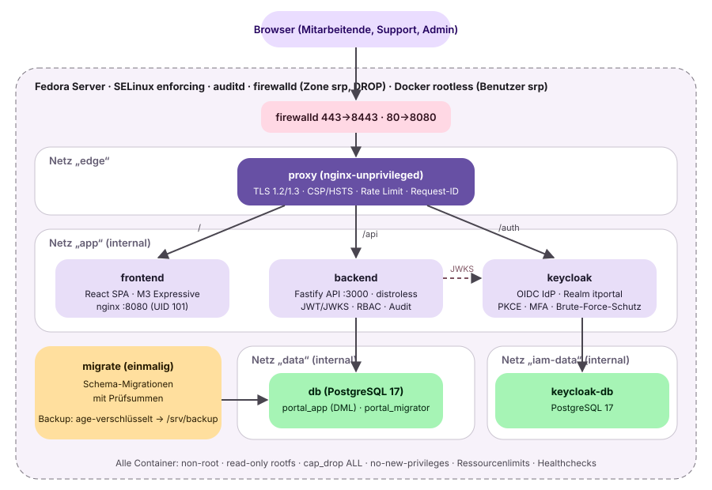

# Einleitung

Dieses Betriebskonzept beschreibt Aufbau, Inbetriebnahme und den laufenden Betrieb des IT-Service-Request-Portals (*Portal*) auf einem gehärteten **Fedora Server** mit **rootless Docker**. Es definiert Verantwortlichkeiten, Routinetätigkeiten, Backup/Restore, Monitoring, Update- und Eskalationsprozesse.

## Betriebsparameter

| Parameter | Zielwert |
|---|---|
| Servicezeit (Support) | Mo–Fr 08:00–17:00 |
| Betriebszeit (System) | 24/7, Wartungsfenster Di 18:00–20:00 |
| Verfügbarkeit (Ziel) | 99,5 % in der Servicezeit |
| RPO (max. Datenverlust) | 24 h (tägliches Backup), optional 1 h mit WAL-Archivierung |
| RTO (max. Wiederanlaufzeit) | 4 h |
| Unterstützte Nutzerzahl | bis ca. 20.000 Beschäftigte, 200 gleichzeitige Sitzungen (Referenzsystem) |

## Verantwortlichkeiten (RACI)

| Aufgabe | IT-Betrieb | IAM-Team | Service Owner | Entwicklung | ISB |
|---|:-:|:-:|:-:|:-:|:-:|
| Server-Härtung & OS-Patches | **R/A** | – | I | – | C |
| Container-Updates & Deployment | **R** | I | A | C | I |
| Keycloak-Konfiguration, Rollenvergabe | C | **R/A** | C | – | I |
| Katalog, Workflow, SLA (Admin-Bereich) | – | – | **R/A** | – | I |
| Backup & Restore-Tests | **R/A** | – | I | – | I |
| Monitoring & Störungsbehebung | **R/A** | C | I | C | I |
| Schwachstellenbehebung Anwendung | C | – | A | **R** | C |
| Sicherheitsvorfälle | R | R | I | C | **A** |

R = verantwortlich (Durchführung), A = rechenschaftspflichtig, C = konsultiert, I = informiert

# Systemarchitektur



## Komponenten

| Dienst | Image / Technologie | Port (intern) | Benutzer | Persistenz |
|---|---|---|---|---|
| `proxy` | nginx-unprivileged 1.27 (eigenes Image) | 8443 / 8080 (publiziert) | 101 | – (Zertifikate read-only gemountet) |
| `frontend` | React-SPA, nginx-unprivileged | 8080 | 101 | – |
| `backend` | Node.js 22, Fastify 5, distroless | 3000 | 65532 | – |
| `migrate` | wie Backend, einmaliger Job | – | 65532 | – |
| `db` | PostgreSQL 17 (alpine) | 5432 | 70 | Volume `portal_db_data` |
| `keycloak` | Keycloak 26 (optimiertes Image) | 8080, Mgmt 9000 | 1000 | – (Daten in keycloak-db) |
| `keycloak-db` | PostgreSQL 17 (alpine) | 5432 | 70 | Volume `keycloak_db_data` |

## Netze und Ports

| Netz | Typ | Teilnehmer |
|---|---|---|
| `edge` | bridge (mit Außenverbindung) | proxy |
| `app` | internal | proxy, frontend, backend, keycloak |
| `data` | internal | backend, migrate, db |
| `iam-data` | internal | keycloak, keycloak-db |

Extern erreichbar sind ausschließlich **443/tcp** und **80/tcp** (firewalld leitet auf 8443/8080 des Proxys weiter) sowie **22/tcp** aus dem Admin-Netz.

## URL-Struktur

| Pfad | Ziel | Besonderheiten |
|---|---|---|
| `/` | Frontend (SPA) | strikte CSP, nur GET/HEAD |
| `/api/` | Backend | Bearer-Token, Rate Limit 20 r/s je IP, Body ≤ 64 KiB |
| `/auth/realms/itportal/…` | Keycloak | Login/Token-Endpunkte 10 r/min je IP |
| `/auth/admin/`, `/auth/realms/master/` | Keycloak-Administration | nur aus `ADMIN_ALLOW_CIDR` |
| `/auth/*` (sonstige, z. B. metrics) | gesperrt | 404 |

## Verzeichnisse auf dem Server

| Pfad | Inhalt | Rechte |
|---|---|---|
| `/srv/srp/app` | Projekt (Compose, Konfiguration, Skripte) | `srp:srp` 0750 |
| `/srv/srp/app/secrets/` | Docker-Secrets (DB-Passwörter) | Verzeichnis 0700, Dateien 0444 |
| `/srv/srp/app/.env` | Umgebungskonfiguration | 0600 |
| `/srv/srp/app/proxy/certs/` | TLS-Zertifikat und Schlüssel | Verzeichnis 0700 |
| `/home/srp/.local/share/docker` | Rootless-Docker-Daten (Images, Volumes) | `srp` |
| `/srv/backup/srp/` | verschlüsselte Backups | 0700 |

::: info
`/srv` (inkl. der Docker-Daten unter `/home/srp`, ggf. per Bind-Mount nach `/srv` verlegt) liegt auf einem **LUKS2-verschlüsselten** Volume. Die Entsperrung erfolgt beim Boot über TPM2/Clevis-Tang (netzgebunden) oder manuell durch den Betrieb.
:::

# Inbetriebnahme

## Voraussetzungen

* Fedora Server ≥ 41, 4 vCPU, 8 GB RAM, 60 GB SSD (Daten) – Referenzgröße,
* DNS-Eintrag `PORTAL_HOSTNAME`, TLS-Zertifikat der Unternehmens-PKI (Server-Auth, SAN = Hostname),
* interne NTP-Server, Admin-Netz (CIDR), personalisierte Admin-Konten mit SSH-Schlüssel,
* Zugriff auf Container-Registries (Docker Hub, quay.io, gcr.io) bzw. interne Registry-Spiegel,
* `age`-Schlüsselpaar für Backups (privater Schlüssel im Tresor).

## Schritt 1 – Server härten

```bash
sudo ADMIN_CIDR=10.10.0.0/24 ADMIN_USERS="max.admin erika.ops" \
     NTP_SERVERS="ntp1.example.local ntp2.example.local" \
     /pfad/zum/projekt/fedora-hardening/scripts/harden.sh
sudo systemctl reboot
sudo /srv/srp/app/fedora-hardening/scripts/verify.sh     # alle Prüfungen PASS
```

Alternativ: `ansible-playbook -i inventory.ini site.yml` (siehe `fedora-hardening/README.md`). Das Skript richtet u. a. das Dienstkonto `srp`, rootless Docker (mit slirp4netns-Porttreiber zur Erhaltung der Client-IP), firewalld-Zone `srp`, auditd, journald, dnf-automatic, AIDE und den Backup-Timer ein.

## Schritt 2 – Projekt bereitstellen

```bash
sudo rsync -a service-request-portal/ /srv/srp/app/
sudo chown -R srp:srp /srv/srp/app
sudo -u srp bash
export XDG_RUNTIME_DIR=/run/user/$(id -u) DOCKER_HOST=unix:///run/user/$(id -u)/docker.sock
cd /srv/srp/app
```

## Schritt 3 – Konfiguration und Secrets

```bash
./scripts/init-secrets.sh
vi .env
```

| Variable | Bedeutung | Beispiel |
|---|---|---|
| `PORTAL_HOSTNAME` | Öffentlicher FQDN | `portal.example.local` |
| `ADMIN_ALLOW_CIDR` | Netz für Keycloak-Admin-Konsole | `10.10.0.0/24` |
| `KEYCLOAK_ADMIN_USER/PASSWORD` | Temporärer Bootstrap-Admin | zufällig erzeugt |
| `KEYCLOAK_DB_PASSWORD` | Keycloak-DB | zufällig erzeugt |
| `KEYCLOAK_ADMIN_API_SECRET` | Secret des Service-Accounts `portal-admin-api` (Benutzer & Rollen) | zufällig erzeugt |
| `ALLOWED_EMAIL_DOMAINS` | Domains für selbst registrierte Konten (kommagetrennt) | `firma.de,firma-gruppe.de` |
| `RATE_LIMIT_MAX` | API-Requests/Minute je IP | `300` |
| `RETENTION_TICKET_DAYS` | Anonymisierung abgeschlossener Tickets | `1095` |
| `RETENTION_AUDIT_DAYS` | Löschung Audit-Log | `365` |
| `RETENTION_IP_DAYS` | Entfernung IP-Adressen | `90` |
| `BACKUP_DIR` | Backup-Ziel | `/srv/backup/srp` |
| `BACKUP_AGE_RECIPIENT` | age-Public-Key | `age1…` |
| `BACKUP_RETENTION_DAYS` | Aufbewahrung Backups | `30` |
| `DB_SSLMODE` | TLS zur DB (internes Netz: `disable`) | `disable` |

## Schritt 4 – TLS-Zertifikat

Zertifikat (inkl. Zwischenzertifikate) als `proxy/certs/tls.crt`, privaten Schlüssel als `proxy/certs/tls.key` ablegen (ECDSA P-384 oder RSA ≥ 3072 bit). Rechte: Dateien 0444, Verzeichnis 0700. Für Testumgebungen: `./scripts/gen-selfsigned-cert.sh`.

## Schritt 5 – Bauen und starten

```bash
docker compose build --pull
docker compose up -d
docker compose ps          # alle Dienste "healthy", migrate "exited (0)"
./scripts/smoke-test.sh    # Funktions- und Sicherheitsprüfung
```

Beim ersten Start legt PostgreSQL die Rollen `portal_migrator` und `portal_app` an, der Dienst `migrate` spielt das Schema und die Stammdaten ein, und Keycloak importiert den Realm `itportal`.

## Schritt 6 – Keycloak einrichten

1. Admin-Konsole aus dem Admin-Netz öffnen: `https://<PORTAL_HOSTNAME>/auth/admin/` und mit dem Bootstrap-Konto anmelden.
2. Im **Master-Realm** personalisierte Admin-Konten anlegen, Rolle `admin` zuweisen, **OTP** als Required Action setzen.
3. **Bootstrap-Konto löschen** und `KEYCLOAK_ADMIN_PASSWORD` aus `.env` entfernen.
4. Realm `itportal` prüfen: Clients `portal-frontend` (öffentlich, PKCE S256, Redirect-URI `https://<host>/*`) und `portal-api` (Audience), Client-Scope `portal-api-audience`, Gruppen und Realm-Rollen.
5. **Benutzeranbindung:** *User Federation → LDAP/Active Directory* (Modus *READ_ONLY*, LDAPS, Bind-Konto mit Leserechten) einrichten; Gruppen über *group-ldap-mapper* auf `/Mitarbeitende`, `/IT-UHD`, `/IT-Portal-Admins` abbilden **oder** Gruppenmitgliedschaften direkt in Keycloak pflegen.
6. **Kein Mailserver:** Die Selbstregistrierung arbeitet ohne E-Mail-Bestätigung; „Passwort vergessen“ ist deaktiviert. Passwörter setzt die Administration in Keycloak zurück (temporäres Passwort).
7. Ersten Portal-Admin festlegen: dem eigenen Konto in Keycloak die Gruppe `/IT-Portal-Admins` zuweisen. Alle weiteren Rollen werden danach im Portal unter *Admin → Benutzer & Rollen* vergeben.
8. Demo-Benutzer (nur Test) aus `keycloak/import/` entfernen.
9. **Login-Theme:** Das Image enthält das Theme `itportal` (Material 3 Expressive, Dark/Light nach Systemeinstellung, Schrift lokal eingebunden). Der Realm-Import setzt es automatisch; bei bestehenden Realms unter *Realm settings → Themes → Login theme* `itportal` wählen. Anpassungen (Farben, Texte) erfolgen in `keycloak/themes/itportal/login/` (CSS-Variablen in `resources/css/itportal.css`, Texte in `messages/`), danach Image neu bauen.

**Bestehende Installation (Realm bereits importiert):** Der Import überschreibt keinen vorhandenen Realm. Für Selbstregistrierung und Rollenverwaltung in der Admin-Konsole einmalig: *Realm settings → Login*: „User registration“ aktivieren, „Verify email“ und „Forgot password“ deaktivieren; *Realm settings → User registration → Default groups*: `/Mitarbeitende`; *Clients → Create*: `portal-admin-api` (Client authentication an, nur *Service accounts roles*), Secret = `KEYCLOAK_ADMIN_API_SECRET`; *Service account roles*: `realm-management` → `query-users`, `view-users`, `query-groups`, `manage-users`.

::: warning
Der Realm-Import erfolgt nur, wenn der Realm noch nicht existiert. Spätere Änderungen werden **in der Admin-Konsole** vorgenommen und über den Export (`kc.sh export --realm itportal`) versioniert.
:::

## Schritt 7 – Abnahme

| Prüfung | Erwartung |
|---|---|
| `verify.sh` | keine Abweichungen |
| `smoke-test.sh` | alle Prüfungen ✓ |
| Login als Testnutzer je Rolle | korrekte Navigation, `/api/me` liefert Rollen |
| Zugriff `/support` als `user` | „Kein Zugriff“, Audit-Eintrag `authz.denied` bei API-Aufruf |
| Ticket anlegen → bearbeiten → lösen → bestätigen | Verlauf, Audit-Einträge, SLA-Felder plausibel |
| Audit → „Integrität prüfen“ | „Hash-Kette intakt“ |
| SSL-Test (z. B. testssl.sh) | nur TLS 1.2/1.3, keine schwachen Suiten |
| Backup + Restore in Testumgebung | erfolgreich, Daten vollständig |

# Laufender Betrieb

## Routinetätigkeiten

| Intervall | Tätigkeit | Verantwortlich |
|---|---|---|
| täglich (automatisch) | Backup 02:15, Löschlauf, dnf-automatic, AIDE 04:30 | System |
| täglich | Monitoring-Dashboard/Alarme prüfen, fehlgeschlagene Timer (`systemctl --failed`) | Betrieb |
| wöchentlich | Image- und Abhängigkeitsscan, Auswertung `npm audit`, AIDE-Berichte | Betrieb / Entwicklung |
| monatlich | `verify.sh`, Audit-Integritätsprüfung, Speicherplatz, Zertifikatslaufzeit | Betrieb / Admin |
| quartalsweise | Restore-Test, Rollen-Rezertifizierung, Keycloak-Review (Clients, Admins) | Betrieb / IAM |
| jährlich | Notfallübung, Penetrationstest, Überprüfung der Konzepte | ISB / Service Owner |

## Wichtige Befehle

Alle Befehle als Benutzer `srp` im Verzeichnis `/srv/srp/app` (mit gesetztem `DOCKER_HOST`).

| Zweck | Befehl |
|---|---|
| Status | `docker compose ps` |
| Logs (live) | `docker compose logs -f --tail=200 backend proxy` |
| Logs des Docker-Daemons | `journalctl --user -u docker -f` |
| Neustart eines Dienstes | `docker compose restart backend` |
| Gesamtstopp / -start | `docker compose down` / `docker compose up -d` |
| Ressourcen | `docker stats --no-stream` |
| DB-Konsole (lesend) | `docker compose exec db psql -U postgres -d portal` |
| Keycloak-Realm-Export | `docker compose exec keycloak /opt/keycloak/bin/kc.sh export --dir /tmp/export --realm itportal` |

::: warning
`docker compose down -v` löscht die Datenbank-Volumes. Dieser Befehl darf in Produktion **nicht** verwendet werden.
:::

## Monitoring und Logging

**Gesundheitsprüfungen:** Alle Container besitzen Healthchecks; Docker startet fehlerhafte Container automatisch neu (`restart: unless-stopped`).

| Endpunkt / Quelle | Zweck | Erreichbarkeit |
|---|---|---|
| `https://<host>/healthz` | Proxy lebt | extern |
| `https://<host>/api/health/live` | Backend-Prozess | extern (ohne Details) |
| `https://<host>/api/health/ready` | Backend + DB | extern (ohne Details) |
| Keycloak `:9000/auth/health/ready`, `/auth/metrics` | IdP-Zustand, Prometheus-Metriken | nur intern (Netz `app`) |
| `docker compose ps` Health-Status | Containerzustand | Server |

**Empfohlene Alarme** (z. B. via Prometheus/Alertmanager, Zabbix oder Checkmk):

| Alarm | Schwelle | Priorität |
|---|---|---|
| `/api/health/ready` ≠ 200 | 3 × in Folge (1 min) | P1 |
| Container *unhealthy* oder Restart-Schleife | > 3 Neustarts / 15 min | P1 |
| TLS-Zertifikat läuft ab | < 21 Tage | P2 |
| Datenträger `/srv` | > 80 % | P2 |
| Backup-Timer fehlgeschlagen | 1 × | P2 |
| HTTP 5xx-Rate | > 2 % über 5 min | P2 |
| HTTP 429-Spitzen / Login-Fehler | ungewöhnlicher Anstieg | P2 (Sicherheit) |
| AIDE-Abweichung, auditd `srp-secrets` | jede | P1 (Sicherheit) |

**Logging:** Container loggen über den `json-file`-Treiber mit Rotation (20 MB × 5 je Container). Proxy- und Backend-Logs sind JSON-strukturiert und enthalten die **Request-ID**, die auch im Audit-Log gespeichert wird (End-to-End-Korrelation). Die Weiterleitung an das zentrale SIEM erfolgt über einen Log-Shipper (z. B. Fluent Bit oder Vector, liest `~srp/.local/share/docker/containers/*/*-json.log`) sowie für Systemprotokolle per `systemd-journal-upload` oder rsyslog (TLS) – Konfiguration gemäß SIEM-Standard des Unternehmens.

## Kapazität und Performance

| Ressource | Limit (Compose) | Hinweis |
|---|---|---|
| Keycloak | 2 CPU / 1,5 GB | Heap 70 % des Limits |
| Backend | 1 CPU / 512 MB | Pool 15 DB-Verbindungen |
| Portal-DB | 1 CPU / 1 GB | `pg_stat_statements` aktiv |
| Proxy | 1 CPU / 256 MB | |
| Frontend | 0,5 CPU / 128 MB | statische Dateien |

Skalierung: Backend und Frontend sind zustandslos und können horizontal skaliert werden (`docker compose up -d --scale backend=2`; der Proxy verteilt per Docker-DNS). Für Hochverfügbarkeit über mehrere Hosts werden PostgreSQL-Replikation und ein Keycloak-Cluster empfohlen (außerhalb Release 1.0).

# Datensicherung und Wiederherstellung

## Backup

| Merkmal | Ausprägung |
|---|---|
| Umfang | Portal-DB, Keycloak-DB (pg_dump, Custom-Format), Konfiguration (ohne Klartext-Secrets) |
| Zeitpunkt | täglich 02:15 (`srp-backup.timer`, `Persistent=true`) |
| Verschlüsselung | `age` mit Public Key; privater Schlüssel offline (Tresor, Vier-Augen) |
| Integrität | `SHA256SUMS` je Sicherung |
| Aufbewahrung | lokal 30 Tage, Kopie auf zentrales Backup-System (Pull, eigene Aufbewahrung nach Backup-Richtlinie) |
| Protokoll | journald (`srp-backup`), Erfolg/Fehler im Monitoring |

Zusätzlich gesichert werden müssen außerhalb dieses Skripts: `.env`, `secrets/`, `proxy/certs/` (verschlüsselt im Passwort-/Secret-Tresor) und das Git-Repository.

## Restore

```bash
# 1. Backup-Verzeichnis und privaten age-Schlüssel bereitstellen
./scripts/restore.sh /srv/backup/srp/20261127T021500Z ~/age-identity.txt
# 2. Prüfen
./scripts/smoke-test.sh
```

Das Skript prüft die Prüfsummen, fordert eine explizite Bestätigung an, stoppt Proxy/Backend/Keycloak, spielt beide Datenbanken ein, führt Migrationen aus und startet den Stack. Anschließend: Login-Test je Rolle, Audit-Integritätsprüfung, Stichprobe aktueller Tickets.

## Wiederanlauf nach Totalausfall

1. Neuen Fedora Server bereitstellen, `harden.sh` ausführen (ca. 30 min).
2. Projekt aus Git bereitstellen, `.env`, `secrets/`, Zertifikate aus dem Tresor einspielen.
3. `docker compose build && docker compose up -d db keycloak-db` – leere Datenbanken initialisieren.
4. `restore.sh` mit letzter Sicherung.
5. Smoke-Test, Abnahme durch Service Owner, Information der Nutzenden.

Restore-Tests werden **quartalsweise** in einer Testumgebung durchgeführt und protokolliert (Dauer, Ergebnis, Abweichungen).

# Wartung und Updates

## Update-Arten

| Art | Quelle | Vorgehen | Fenster |
|---|---|---|---|
| OS-Sicherheitsupdates | dnf-automatic | automatisch, Neustart bei Bedarf (10 min Vorwarnung) | täglich, nachts |
| OS-Funktionsupdates / Fedora-Release-Upgrade | Fedora | Staging → Produktion, `dnf system-upgrade`; Fedora-Releases haben ca. 13 Monate Support | geplant, 2× jährlich |
| Basis-Images (nginx, PostgreSQL-Minor, distroless, Node) | Registries | `docker compose build --pull && docker compose up -d` | monatlich / bei CVE |
| Anwendungs-Release | Git | Tag auschecken, Build, Migration automatisch, Smoke-Test | Wartungsfenster |
| Keycloak-Minor | quay.io | `KEYCLOAK_VERSION` anheben, Build, Neustart | Wartungsfenster |
| Keycloak-Major / PostgreSQL-Major | Hersteller | Upgrade-Guide beachten, vorher Backup + Test in Staging (PostgreSQL-Major: Dump/Restore) | geplant |

## Standard-Deployment

```bash
cd /srv/srp/app
./scripts/backup.sh                         # Sicherung vor Änderung
git fetch --tags && git checkout v1.1.0      # bzw. Release-Paket entpacken
docker compose build --pull
docker compose up -d                         # migrate läuft vor backend
docker compose ps && ./scripts/smoke-test.sh
```

**Rollback:** vorheriges Tag auschecken, `docker compose up -d`. Enthält das neue Release Datenbankmigrationen, ist ein Rollback nur per Restore der vorherigen Sicherung möglich – daher Migrationen grundsätzlich abwärtskompatibel gestalten (expand/contract).

## Change-Management

* Jede Produktionsänderung erfordert ein **Change-Ticket** (Beschreibung, Risiko, Rollback, Test).
* Standard-Changes (Basis-Image-Updates, Zertifikatstausch) sind vorab genehmigt; normale Changes benötigen Freigabe durch Service Owner; sicherheitsrelevante Changes zusätzlich durch ISB.
* Notfall-Changes (kritische CVE) dürfen sofort umgesetzt und nachträglich dokumentiert werden.

## Zertifikate und Secrets

| Objekt | Laufzeit / Rotation | Vorgehen |
|---|---|---|
| TLS-Zertifikat | gemäß PKI (≤ 1 Jahr) | neue Dateien in `proxy/certs/`, `docker compose restart proxy` |
| Keycloak-Signaturschlüssel | jährlich | *Realm settings → Keys → Add provider (rsa-generated)*, alten Schlüssel nach Ablauf der Token-Laufzeit deaktivieren |
| DB-Passwörter | jährlich / bei Personalwechsel | siehe Informationssicherheitskonzept, Kap. „Secret-Rotation“ |
| `KEYCLOAK_ADMIN_API_SECRET` | jährlich / bei Verdacht | Keycloak: *Clients → portal-admin-api → Credentials → Regenerate*, Wert in `.env` übernehmen, `docker compose up -d backend` |
| SSH-Schlüssel der Admins | bei Ausscheiden sofort | `authorized_keys` bereinigen, Gruppe `sshusers` |

# Störungs- und Eskalationsmanagement

## Support-Ebenen

| Ebene | Zuständigkeit | Erreichbarkeit |
|---|---|---|
| 1st Level | Service Desk: Annahme von Störungsmeldungen zum Portal, Erstanalyse (Erreichbarkeit, Login) | Servicezeit |
| 2nd Level | IT-Betrieb (Server/Container), IAM-Team (Keycloak) | Servicezeit, Rufbereitschaft für P1 |
| 3rd Level | Entwicklung (Anwendungsfehler), Hersteller-/Community-Support | nach Vereinbarung |

## Prioritäten und Reaktionszeiten

| Priorität | Definition | Reaktion | Wiederherstellung | Eskalation an |
|---|---|---|---|---|
| P1 | Portal nicht erreichbar / Login für alle unmöglich / Sicherheitsvorfall | 15 min | 4 h | Leitung IT-Betrieb, ISB (bei Sicherheitsbezug), Service Owner |
| P2 | Teilfunktion gestört (z. B. Support-Queue), Performance stark eingeschränkt | 1 h | 1 Arbeitstag | Teamleitung Betrieb |
| P3 | Einzelne Fehler mit Workaround | 1 Arbeitstag | nächstes Release | Service Owner |

Kann die Wiederherstellungszeit nicht eingehalten werden, eskaliert die/der Bearbeitende zur nächsthöheren Ebene. Bei P1 informiert der Service Desk die Nutzenden über das Intranet und nimmt Anfragen telefonisch entgegen (Fallback-Prozess).

## Runbooks (typische Störungen)

| Symptom | Mögliche Ursache | Maßnahmen |
|---|---|---|
| Startseite lädt, Login-Schleife | Uhrzeit abweichend, falsche `PORTAL_HOSTNAME`/Redirect-URI | `chronyc tracking`; `.env` und Client-Redirect-URIs prüfen |
| „Anmeldung nicht möglich“ / 401 bei allen API-Calls | JWKS nicht erreichbar, Issuer stimmt nicht | `docker compose logs backend` (token verification failed), `OIDC_ISSUER` = `https://<host>/auth/realms/itportal` |
| 502/504 vom Proxy | Upstream nicht healthy | `docker compose ps`, Logs des Dienstes, ggf. `restart` |
| Backend startet nicht | Migration fehlgeschlagen, DB-Passwort falsch | `docker compose logs migrate`; Secrets prüfen |
| Keycloak startet langsam/nicht | Speicher, DB nicht erreichbar | Logs, Limits, `keycloak-db` Health |
| Rate-Limit-Fehler (429) bei vielen Nutzern hinter NAT | Schwellen zu niedrig | `limit_req`-Werte bzw. `RATE_LIMIT_MAX` anpassen |
| Client-IP im Log ist intern (10.0.2.x) | Rootless-Porttreiber ohne IP-Weitergabe | `rootless-override.conf` (slirp4netns) prüfen, Docker-User-Dienst neu starten |
| SELinux-Verweigerung bei Bind-Mount | fehlendes Label | Mount-Option `:Z` prüfen; `ausearch -m avc -ts recent` |
| Speicherplatz knapp | Images, Logs, Backups | `docker image prune`, Backup-Rotation, journald-Limits |

# Anhang

## A. Auskunft nach Art. 15 DSGVO (Export einer Person)

```sql
-- Aufruf: docker compose exec -T db psql -U postgres -d portal -v sub="'<keycloak-sub>'" -f - < export.sql
SET search_path = portal;
\pset format unaligned
\pset tuples_only on
SELECT json_build_object(
  'profil',    (SELECT row_to_json(p) FROM user_profiles p WHERE p.sub = :sub),
  'tickets',   (SELECT coalesce(json_agg(t), '[]') FROM (
                  SELECT number, title, description, form_data, status, priority, created_at, closed_at
                    FROM tickets WHERE requester_sub = :sub) t),
  'kommentare',(SELECT coalesce(json_agg(c), '[]') FROM (
                  SELECT tk.number, c.body, c.created_at FROM ticket_comments c
                    JOIN tickets tk ON tk.id = c.ticket_id
                   WHERE c.author_sub = :sub AND NOT c.internal) c),
  'audit',     (SELECT coalesce(json_agg(a), '[]') FROM (
                  SELECT ts, action, entity_type, entity_id, outcome, host(client_ip) AS ip
                    FROM audit_log WHERE actor_sub = :sub ORDER BY ts) a)
);
```

Interne Notizen sind vor Herausgabe durch die/den DSB auf Rechte Dritter zu prüfen (Art. 15 Abs. 4 DSGVO).

## B. Prüfliste vor Produktivsetzung

- [ ] Härtung angewendet, `verify.sh` ohne Abweichungen, Neustart erfolgt
- [ ] LUKS-Verschlüsselung `/srv` aktiv, FSS-Schlüssel offline gesichert
- [ ] PKI-Zertifikat eingespielt, testssl-Prüfung bestanden
- [ ] Bootstrap-Admin gelöscht, personalisierte Keycloak-Admins mit MFA
- [ ] Demo-Benutzer entfernt, LDAP/AD-Anbindung getestet
- [ ] `package-lock.json` versioniert, Image-Scan ohne kritische Befunde
- [ ] Backup + Restore getestet, Kopie auf zentrales Backup-System eingerichtet
- [ ] Monitoring und SIEM-Anbindung aktiv, Alarme getestet
- [ ] Informationssicherheits- und Datenschutzkonzept freigegeben, Betriebsrat beteiligt
- [ ] Nutzende informiert (Benutzerhandbuch, Datenschutzhinweis)

## C. Änderungshistorie

| Version | Datum | Änderung |
|---|---|---|
| 1.0 | November 2026 | Erstfassung |
